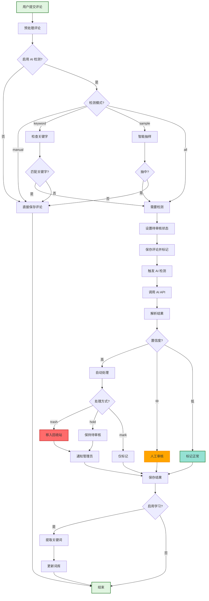
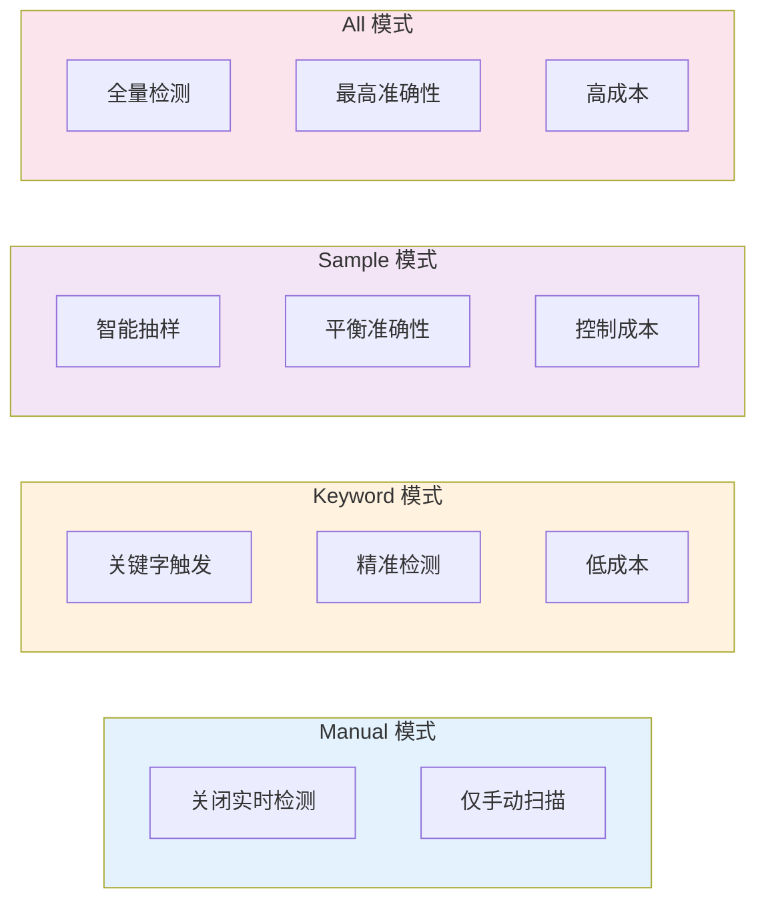
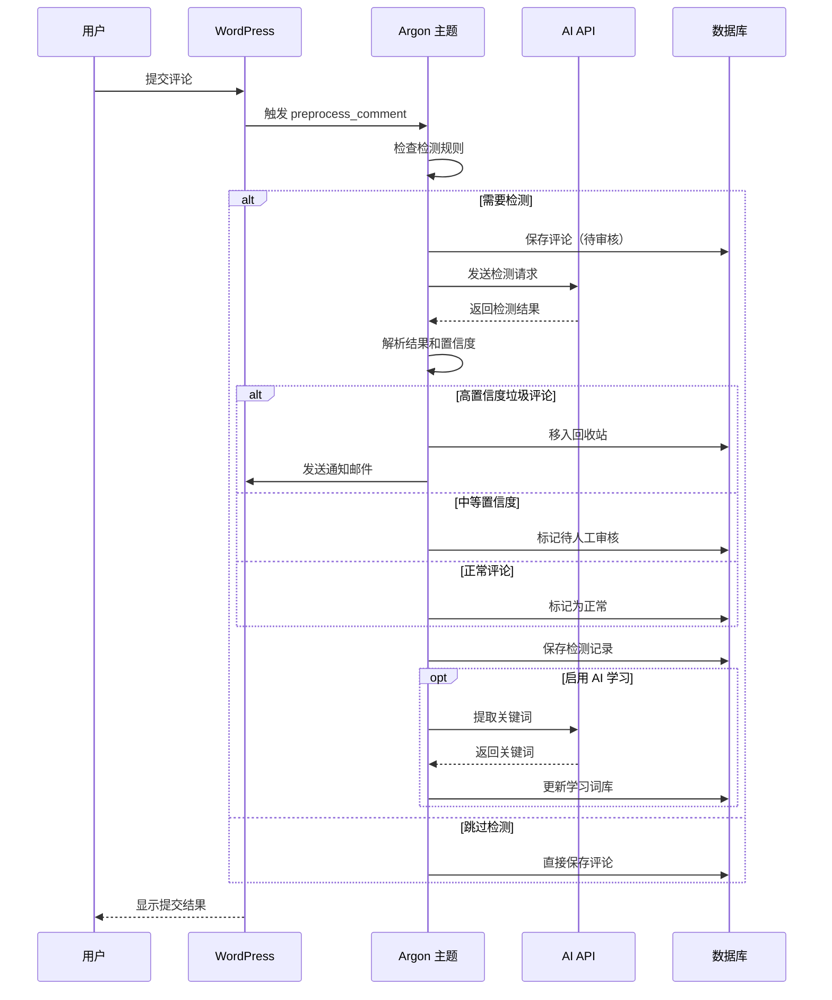
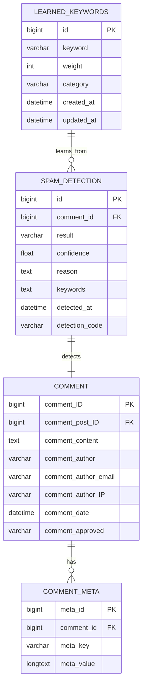
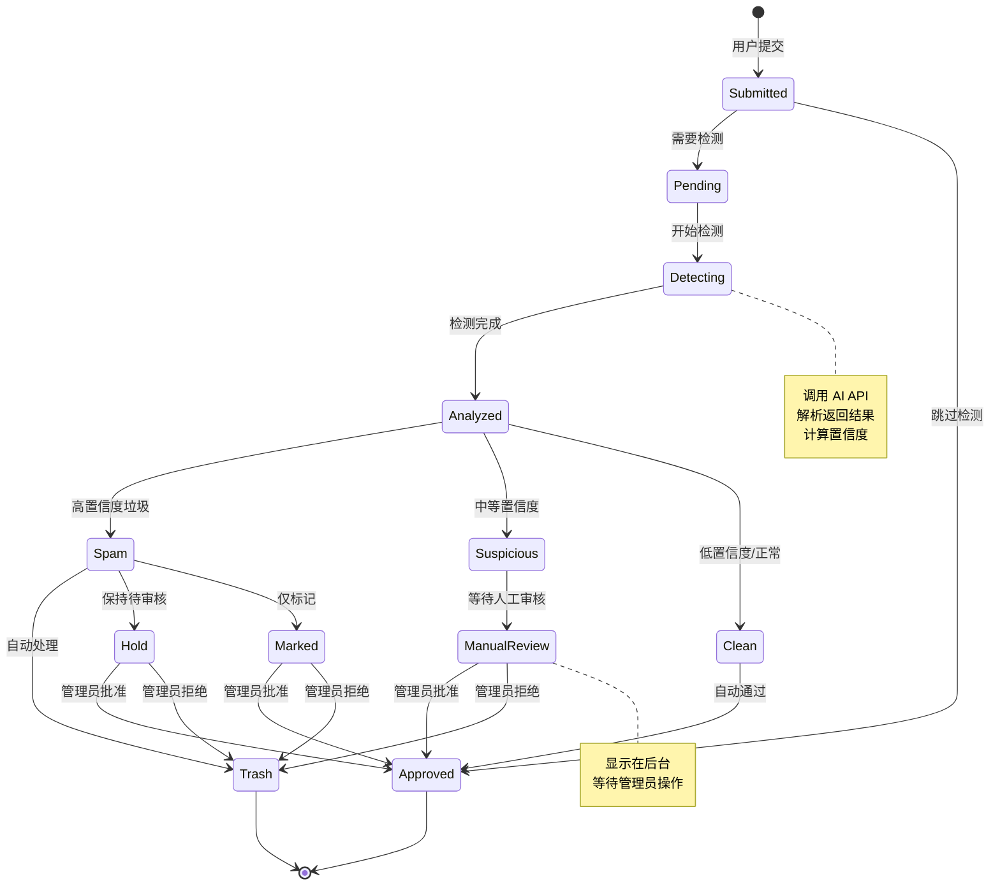
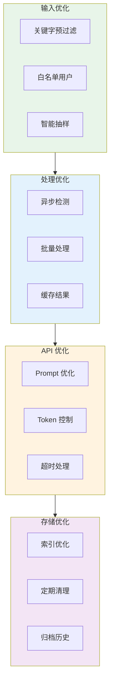

# AI 垃圾评论检测系统架构

## 系统概述

本文档展示 Argon 主题的 AI 垃圾评论检测系统的完整架构和流程。

## 主流程图

## 检测模式详解

## AI 检测流程

## 数据库结构

## 系统状态机

## 性能优化策略

## 关键技术点

### 1. 异步检测机制
- 评论提交后立即返回，不阻塞用户
- 后台异步调用 AI API 进行检测
- 使用 WordPress Cron 或队列系统

### 2. 智能抽样算法
- 基于用户历史行为的动态抽样率
- 新用户抽样率更高
- 可信用户抽样率降低

### 3. 置信度评分系统
- 0.9-1.0：非常确定，可自动处理
- 0.7-0.9：比较确定，建议自动处理
- 0.5-0.7：中等确定，建议人工审核
- 0.0-0.5：不太确定，必须人工审核

### 4. 学习优化机制
- 记录管理员的审核决策
- 分析误判模式
- 自动调整检测策略
- 提取高频垃圾关键词

### 5. 容错与降级
- API 失败时自动降级
- 保证评论系统正常运行
- 记录错误日志供后续分析

## 配置建议

### 小型博客（< 100 评论/天）
- 检测模式：Sample（30%）
- Prompt 模式：Standard
- 自动处理阈值：0.9
- 异步检测：启用

### 中型博客（100-500 评论/天）
- 检测模式：Sample（40%）
- Prompt 模式：Standard
- 自动处理阈值：0.85
- 异步检测：启用
- 批量扫描：每日一次

### 大型博客（> 500 评论/天）
- 检测模式：Keyword + Sample（50%）
- Prompt 模式：Minimal
- 自动处理阈值：0.8
- 异步检测：启用
- 批量扫描：每日两次
- 启用缓存和队列优化
