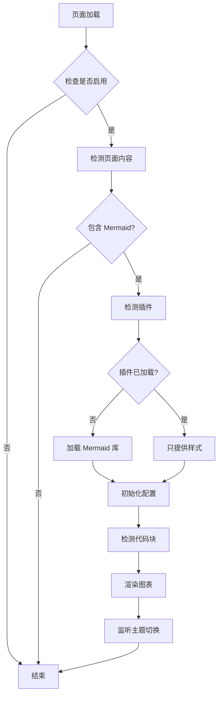

# Mermaid 功能开发者文档

## 目录

1. [架构概述](#架构概述)
2. [PHP 函数参考](#php-函数参考)
3. [JavaScript API 参考](#javascript-api-参考)
4. [配置系统](#配置系统)
5. [扩展开发](#扩展开发)
6. [测试指南](#测试指南)

---

## 架构概述

### 系统组成

Mermaid 功能由以下几个部分组成：

```
┌─────────────────────────────────────────┐
│          WordPress 后台设置              │
│         (settings.php)                  │
└──────────────┬──────────────────────────┘
               │
               ├─> 配置管理 (functions.php)
               │   ├─ argon_get_mermaid_option()
               │   ├─ argon_update_mermaid_option()
               │   └─ argon_validate_mermaid_settings()
               │
               ├─> 库加载器 (functions.php)
               │   ├─ argon_enqueue_mermaid_scripts()
               │   ├─ argon_has_mermaid_content()
               │   └─ argon_get_mermaid_library_url()
               │
               ├─> 插件兼容层 (functions.php)
               │   ├─ argon_detect_mermaid_plugins()
               │   ├─ argon_is_mermaid_library_enqueued()
               │   └─ argon_should_load_mermaid_library()
               │
               └─> 前端渲染引擎 (argontheme.js)
                   ├─ MermaidRenderer.init()
                   ├─ MermaidRenderer.detectMermaidBlocks()
                   ├─ MermaidRenderer.renderChart()
                   └─ MermaidRenderer.handleThemeSwitch()
```

### 工作流程



---

## PHP 函数参考

### 配置管理函数

#### argon_get_mermaid_option()

获取 Mermaid 配置选项。

**函数签名：**
```php
function argon_get_mermaid_option($option_name, $default = null)
```

**参数：**
- `$option_name` (string) - 配置选项名称，支持简短名称或完整名称
- `$default` (mixed) - 默认值，当选项不存在时返回

**返回值：**
- (mixed) 配置选项值

**支持的选项名称：**
| 简短名称 | 完整名称 | 说明 |
|---------|---------|------|
| `enabled` | `argon_enable_mermaid` | 是否启用 Mermaid |
| `cdn_source` | `argon_mermaid_cdn_source` | CDN 来源 |
| `custom_cdn_url` | `argon_mermaid_cdn_custom_url` | 自定义 CDN URL |
| `theme` | `argon_mermaid_theme` | 图表主题 |
| `use_local` | `argon_mermaid_use_local` | 使用本地镜像 |
| `debug_mode` | `argon_mermaid_debug_mode` | 调试模式 |

**示例：**
```php
// 使用简短名称
$enabled = argon_get_mermaid_option('enabled', false);

// 使用完整名称
$theme = argon_get_mermaid_option('argon_mermaid_theme', 'auto');

// 获取不存在的选项，返回默认值
$custom = argon_get_mermaid_option('custom_option', 'default_value');
```

---

#### argon_update_mermaid_option()

保存 Mermaid 配置选项。

**函数签名：**
```php
function argon_update_mermaid_option($option_name, $value)
```

**参数：**
- `$option_name` (string) - 配置选项名称
- `$value` (mixed) - 配置选项值

**返回值：**
- (bool) 是否保存成功

**示例：**
```php
// 启用 Mermaid
argon_update_mermaid_option('enabled', true);

// 设置主题
argon_update_mermaid_option('theme', 'dark');

// 设置 CDN 来源
argon_update_mermaid_option('cdn_source', 'jsdelivr');
```

---

#### argon_validate_mermaid_cdn_url()

验证 Mermaid CDN URL 格式。

**函数签名：**
```php
function argon_validate_mermaid_cdn_url($url)
```

**参数：**
- `$url` (string) - CDN URL

**返回值：**
- (bool) 是否为有效的 CDN URL

**验证规则：**
1. URL 不能为空
2. 必须是有效的 URL 格式
3. 必须以 `.js` 结尾
4. 必须使用 `http://` 或 `https://` 协议

**示例：**
```php
// 有效的 URL
$valid = argon_validate_mermaid_cdn_url('https://cdn.example.com/mermaid.min.js');
// 返回: true

// 无效的 URL（不以 .js 结尾）
$invalid = argon_validate_mermaid_cdn_url('https://cdn.example.com/mermaid');
// 返回: false
```

---

#### argon_get_mermaid_theme()

获取当前主题模式对应的 Mermaid 主题。

**函数签名：**
```php
function argon_get_mermaid_theme()
```

**返回值：**
- (string) Mermaid 主题名称

**说明：**
- 如果配置为固定主题，直接返回配置的主题
- 如果配置为 `auto`，在 PHP 端返回 `default`，实际切换在 JavaScript 中实现

**示例：**
```php
$theme = argon_get_mermaid_theme();
// 返回: 'default', 'dark', 'forest', 'neutral' 之一
```

---

### 库加载函数

#### argon_has_mermaid_content()

检测页面内容是否包含 Mermaid 代码块。

**函数签名：**
```php
function argon_has_mermaid_content($content)
```

**参数：**
- `$content` (string) - 页面内容

**返回值：**
- (bool) 是否包含 Mermaid 代码块

**支持的格式：**
- `<div class="mermaid">`
- `<pre><code class="language-mermaid">`
- `<pre data-lang="mermaid">`
- `<code class="mermaid">`

**示例：**
```php
global $post;
if (argon_has_mermaid_content($post->post_content)) {
    // 页面包含 Mermaid 代码块
    echo '检测到 Mermaid 图表';
}
```

---

#### argon_get_mermaid_library_url()

获取 Mermaid 库的 URL。

**函数签名：**
```php
function argon_get_mermaid_library_url()
```

**返回值：**
- (string) Mermaid 库 URL

**说明：**
- 根据配置返回对应的 CDN 或本地路径
- 如果自定义 URL 无效，自动降级到 jsDelivr

**示例：**
```php
$url = argon_get_mermaid_library_url();
// 返回: 'https://cdn.jsdelivr.net/npm/mermaid@10/dist/mermaid.min.js'
```

---

#### argon_enqueue_mermaid_scripts()

加载 Mermaid JavaScript 库。

**函数签名：**
```php
function argon_enqueue_mermaid_scripts()
```

**说明：**
- 在 `wp_enqueue_scripts` 钩子中调用
- 只在启用 Mermaid 且页面包含代码块时加载
- 自动检测插件，避免重复加载

**钩子：**
```php
add_action('wp_enqueue_scripts', 'argon_enqueue_mermaid_scripts');
```

---

### 插件兼容函数

#### argon_detect_mermaid_plugins()

检测已安装的 Mermaid 相关插件。

**函数签名：**
```php
function argon_detect_mermaid_plugins()
```

**返回值：**
- (array) 插件检测结果数组

**返回格式：**
```php
[
    'wp-githuber-md' => false,
    'markdown-block' => false,
    'code-syntax-block' => false,
    'mermaid-loaded' => false
]
```

**示例：**
```php
$plugins = argon_detect_mermaid_plugins();
if ($plugins['wp-githuber-md']) {
    echo 'WP Githuber MD 插件已安装';
}
```

---

#### argon_is_mermaid_library_enqueued()

检查是否有插件已经加载了 Mermaid 库。

**函数签名：**
```php
function argon_is_mermaid_library_enqueued()
```

**返回值：**
- (bool) 是否已加载

**说明：**
- 检测常见的 Mermaid 脚本句柄
- 包括：`mermaid`, `mermaid-js`, `githuber-mermaid`, `wp-mermaid`, `markdown-mermaid`

**示例：**
```php
if (argon_is_mermaid_library_enqueued()) {
    echo 'Mermaid 库已由其他来源加载';
}
```

---

#### argon_should_load_mermaid_library()

判断是否应该加载 Mermaid 库。

**函数签名：**
```php
function argon_should_load_mermaid_library()
```

**返回值：**
- (bool) 是否应该加载

**说明：**
- 检测插件和已加载的库
- 避免重复加载
- 在调试模式下输出日志

**示例：**
```php
if (argon_should_load_mermaid_library()) {
    // 主题负责加载 Mermaid 库
    wp_enqueue_script('mermaid', $url);
}
```

---

## JavaScript API 参考

### MermaidRenderer 对象

前端渲染引擎，负责检测和渲染 Mermaid 图表。

#### 属性

| 属性 | 类型 | 说明 |
|------|------|------|
| `initialized` | boolean | 是否已初始化 |
| `rendered` | Set | 已渲染的图表 ID 集合 |
| `config` | Object | 配置对象 |

---

#### init()

初始化 Mermaid 配置并渲染所有图表。

**函数签名：**
```javascript
MermaidRenderer.init()
```

**返回值：**
- (boolean) 是否初始化成功

**说明：**
- 检查 Mermaid 库是否已加载
- 初始化 Mermaid 配置
- 渲染所有图表
- 监听主题切换事件

**示例：**
```javascript
// 页面加载完成后初始化
document.addEventListener('DOMContentLoaded', function() {
    if (typeof MermaidRenderer !== 'undefined') {
        MermaidRenderer.init();
    }
});
```

---

#### detectMermaidBlocks()

检测所有 Mermaid 代码块。

**函数签名：**
```javascript
MermaidRenderer.detectMermaidBlocks()
```

**返回值：**
- (Array) Mermaid 代码块元素数组

**检测规则：**
1. `div.mermaid` - 标准格式
2. `pre code.language-mermaid` - Markdown 格式
3. `pre[data-lang="mermaid"]` - 自定义属性格式
4. `code.mermaid` - 简化格式

**示例：**
```javascript
const blocks = MermaidRenderer.detectMermaidBlocks();
console.log(`检测到 ${blocks.length} 个 Mermaid 代码块`);
```

---

#### extractMermaidCode()

提取代码块内容。

**函数签名：**
```javascript
MermaidRenderer.extractMermaidCode(element)
```

**参数：**
- `element` (HTMLElement) - 代码块元素

**返回值：**
- (string) Mermaid 代码

**说明：**
- 支持多种代码块格式
- 自动处理 WP-Markdown 生成的 `document.write()` 格式
- 解码转义字符（`\n`, `\"`, `\'`）

**示例：**
```javascript
const element = document.querySelector('.mermaid');
const code = MermaidRenderer.extractMermaidCode(element);
console.log(code);
```

---

#### renderChart()

渲染单个图表。

**函数签名：**
```javascript
MermaidRenderer.renderChart(element, index)
```

**参数：**
- `element` (HTMLElement) - 代码块元素
- `index` (number) - 图表索引

**说明：**
- 生成唯一的图表 ID
- 避免重复渲染
- 渲染成功后替换原始代码块
- 渲染失败时显示错误提示

**示例：**
```javascript
const blocks = MermaidRenderer.detectMermaidBlocks();
blocks.forEach((block, index) => {
    MermaidRenderer.renderChart(block, index);
});
```

---

#### handleThemeSwitch()

处理主题切换事件。

**函数签名：**
```javascript
MermaidRenderer.handleThemeSwitch()
```

**说明：**
- 检测页面主题变化
- 重新渲染所有图表
- 使用新的主题配置

**示例：**
```javascript
// 监听主题切换
document.addEventListener('themeChanged', function() {
    MermaidRenderer.handleThemeSwitch();
});
```

---

### 配置对象

#### argonMermaidConfig

全局配置对象，由 PHP 传递到前端。

**属性：**
```javascript
{
    enabled: true,                    // 是否启用
    theme: 'auto',                    // 图表主题
    debugMode: false,                 // 调试模式
    fallbackUrls: [],                 // 备用 CDN URL 列表
    libraryLoadedByPlugin: false      // 库是否由插件加载
}
```

**访问方式：**
```javascript
if (window.argonMermaidConfig) {
    console.log('Mermaid 已启用:', argonMermaidConfig.enabled);
    console.log('当前主题:', argonMermaidConfig.theme);
}
```

---

## 配置系统

### 配置选项

| 选项名称 | 类型 | 默认值 | 说明 |
|---------|------|--------|------|
| `argon_enable_mermaid` | boolean | false | 是否启用 Mermaid |
| `argon_mermaid_cdn_source` | string | 'jsdelivr' | CDN 来源 |
| `argon_mermaid_cdn_custom_url` | string | '' | 自定义 CDN URL |
| `argon_mermaid_theme` | string | 'auto' | 图表主题 |
| `argon_mermaid_use_local` | boolean | false | 使用本地镜像 |
| `argon_mermaid_debug_mode` | boolean | false | 调试模式 |

### CDN 来源选项

| 值 | 说明 | URL |
|----|------|-----|
| `jsdelivr` | jsDelivr CDN | `https://cdn.jsdelivr.net/npm/mermaid@10/dist/mermaid.min.js` |
| `unpkg` | unpkg CDN | `https://unpkg.com/mermaid@10/dist/mermaid.min.js` |
| `custom` | 自定义 CDN | 用户指定的 URL |
| `local` | 本地文件 | `{theme_url}/assets/vendor/mermaid/mermaid.min.js` |

### 主题选项

| 值 | 说明 |
|----|------|
| `auto` | 自动切换（跟随页面主题） |
| `default` | 默认主题（浅色） |
| `dark` | 深色主题 |
| `forest` | 森林主题（绿色） |
| `neutral` | 中性主题（灰色） |

---

## 扩展开发

### 添加新的图表类型支持

Mermaid 支持的所有图表类型都已自动支持，无需额外配置。

### 自定义样式

在 `style.css` 中添加自定义样式：

```css
/* 自定义 Mermaid 容器样式 */
.mermaid-container {
    background: #f5f5f5;
    padding: 20px;
    border-radius: 8px;
    box-shadow: 0 2px 8px rgba(0,0,0,0.1);
}

/* 自定义错误提示样式 */
.mermaid-error-container {
    background: #fff3cd;
    border-left: 4px solid #ffc107;
    padding: 15px;
    border-radius: 4px;
}

/* 夜间模式样式 */
html.darkmode .mermaid-container {
    background: #2d2d2d;
}
```

### 添加自定义钩子

在 `functions.php` 中添加钩子：

```php
/**
 * Mermaid 渲染前钩子
 * 
 * @param string $content 页面内容
 * @return string 修改后的内容
 */
function my_custom_mermaid_before_render($content) {
    // 自定义处理逻辑
    return $content;
}
add_filter('argon_mermaid_before_render', 'my_custom_mermaid_before_render');

/**
 * Mermaid 渲染后钩子
 * 
 * @param string $content 渲染后的内容
 * @return string 修改后的内容
 */
function my_custom_mermaid_after_render($content) {
    // 自定义处理逻辑
    return $content;
}
add_filter('argon_mermaid_after_render', 'my_custom_mermaid_after_render');
```

---

## 测试指南

### 单元测试

运行 PHP 单元测试：

```bash
cd tests
php run-mermaid-config-tests.php
```

### 测试用例

测试文件位于 `tests/` 目录：

- `test-mermaid-config.php` - 配置管理测试
- `test-mermaid-loader.php` - 库加载测试
- `test-mermaid-fallback.php` - CDN 降级测试
- `test-wp-markdown-format.html` - WP-Markdown 格式测试

### 手动测试

1. **基础功能测试**
   - 启用 Mermaid 支持
   - 创建包含 Mermaid 代码的文章
   - 验证图表是否正确渲染

2. **主题切换测试**
   - 切换页面主题（日间/夜间）
   - 验证图表主题是否自动切换

3. **CDN 降级测试**
   - 模拟 CDN 加载失败
   - 验证是否自动尝试备用 CDN

4. **插件兼容测试**
   - 安装 Mermaid 相关插件
   - 验证是否正确检测并避免冲突

5. **错误处理测试**
   - 输入错误的 Mermaid 代码
   - 验证错误提示是否友好

---

## 调试技巧

### 启用调试模式

在主题设置中启用调试模式，查看详细日志：

```javascript
[Argon Mermaid] Mermaid 配置初始化成功 {theme: "default"}
[Argon Mermaid] 检测到 3 个 Mermaid 代码块
[Argon Mermaid] 渲染图表 #mermaid-chart-1234567890-0
[Argon Mermaid] 图表渲染成功
```

### 浏览器控制台

打开浏览器开发者工具（F12），查看：

1. **控制台日志** - 查看 Mermaid 相关日志
2. **网络请求** - 查看 CDN 加载状态
3. **元素检查** - 查看渲染后的 SVG 结构

### PHP 错误日志

在 `wp-config.php` 中启用调试：

```php
define('WP_DEBUG', true);
define('WP_DEBUG_LOG', true);
define('WP_DEBUG_DISPLAY', false);
```

查看日志文件：`wp-content/debug.log`

---

## 性能优化

### 按需加载

主题已实现按需加载，只在包含 Mermaid 代码的页面加载库。

### 异步加载

Mermaid 库使用 `async` 属性异步加载，不阻塞页面渲染。

### CDN 缓存

使用 CDN 加速加载，浏览器会自动缓存库文件。

### 避免重复渲染

使用 `rendered` Set 记录已渲染的图表，避免重复渲染。

---

## 贡献指南

### 代码规范

遵循 Argon 主题的代码规范：

- **PHP**: 遵循 WordPress Coding Standards
- **JavaScript**: 使用 Tab 缩进，严格相等运算符
- **CSS**: 使用 Tab 缩进，属性独占一行

### 提交规范

- **功能添加**: `feat: 添加 XXX 功能`
- **Bug 修复**: `fix: 修复 XXX 问题`
- **文档更新**: `docs: 更新 XXX 文档`

### 测试要求

- 添加新功能时，必须添加对应的测试用例
- 修复 Bug 时，必须添加回归测试
- 所有测试必须通过

---

## 相关资源

- [Mermaid 官方文档](https://mermaid.js.org/)
- [WordPress 开发文档](https://developer.wordpress.org/)
- [Argon 主题 GitHub](https://github.com/solstice23/argon-theme)

---

**最后更新：** 2024-01-22  
**文档版本：** 1.0.0


---

## 代码块魔改技术

### 概述

代码块魔改是一种在代码高亮之前拦截并转换 Mermaid 代码块的技术，使得标准 Markdown 代码块 (` ```mermaid `) 能够正确渲染为 Mermaid 图表，而不被代码高亮处理。

### 实现原理

#### 1. 执行顺序

```
页面加载/PJAX切换
    ↓
highlightJsRender() 调用
    ↓
convertMermaidCodeblocks() 执行 ← 【拦截阶段】
    ↓
代码高亮处理其他代码块
    ↓
MermaidRenderer.detectMermaidBlocks() ← 【检测阶段】
    ↓
MermaidRenderer.renderChart() ← 【渲染阶段】
```

#### 2. 核心函数

**convertMermaidCodeblocks()**

在代码高亮之前转换 Mermaid 代码块。

**位置：** `argontheme.js` 第 3942 行之前

**功能：**
- 使用多个选择器查找 mermaid 代码块
- 提取纯文本代码（使用 `textContent`）
- 创建 `<div class="mermaid-from-codeblock">` 容器
- 替换原始代码块元素
- 添加 `data-processed="true"` 标记防止重复处理

**代码示例：**
```javascript
function convertMermaidCodeblocks(){
	// 支持多种代码块格式
	const selectors = [
		'pre > code.language-mermaid',  // 标准 Markdown 格式（最常见）
		'pre > code.mermaid',           // 简化格式
		'code.language-mermaid',        // 无 pre 包裹
		'pre[data-lang="mermaid"]'      // 自定义属性格式
	];
	
	let processedCount = 0;
	
	selectors.forEach(selector => {
		document.querySelectorAll(selector).forEach(element => {
			// 避免重复处理
			if (element.dataset.mermaidProcessed) {
				return;
			}
			
			// 提取代码
			let code = element.textContent.trim();
			if (!code) {
				return;
			}
			
			// 创建容器
			const container = document.createElement('div');
			container.className = 'mermaid-from-codeblock';
			container.textContent = code;
			container.dataset.processed = 'true';
			
			// 替换元素
			const targetElement = element.closest('pre') || element;
			if (targetElement.parentNode) {
				targetElement.parentNode.replaceChild(container, targetElement);
				processedCount++;
			}
			
			// 标记已处理
			element.dataset.mermaidProcessed = 'true';
		});
	});
	
	if (processedCount > 0 && typeof console !== 'undefined' && console.log) {
		console.log('[Mermaid] 转换了 ' + processedCount + ' 个代码块');
	}
}
```

#### 3. 集成点

**集成点 1：highlightJsRender() 函数**

在函数开始处调用 `convertMermaidCodeblocks()`：

```javascript
function highlightJsRender(){
	// 在代码高亮之前，先处理 Mermaid 代码块
	convertMermaidCodeblocks();
	
	if (typeof(hljs) == "undefined"){
		return;
	}
	// ... 原有的代码高亮逻辑
}
```

**集成点 2：detectMermaidBlocks() 函数**

在 selectors 数组中添加新的容器类型：

```javascript
const selectors = [
	'div.mermaid-shortcode',                 // Shortcode 格式（推荐）
	'div.mermaid-from-codeblock',            // 代码块魔改格式（新增）
	'div.mermaid',                           // 标准格式
	'pre code.language-mermaid',             // Markdown 格式（降级）
	'pre[data-lang="mermaid"]',              // 自定义属性格式
	'code.mermaid'                           // 简化格式
];
```

**集成点 3：extractMermaidCode() 函数**

添加对新容器类型的处理：

```javascript
// 处理代码块魔改格式（新增）
else if (element.classList.contains('mermaid-from-codeblock')) {
	code = element.textContent;
	this.logDebug('从代码块魔改格式提取代码');
}
```

### 技术细节

#### 选择器优先级

选择器按以下优先级匹配：

1. `pre > code.language-mermaid` - 标准 Markdown 格式（最常见）
2. `pre > code.mermaid` - 简化格式
3. `code.language-mermaid` - 无 pre 包裹
4. `pre[data-lang="mermaid"]` - 自定义属性格式

#### 重复处理防护

使用 `data-mermaid-processed` 属性标记已处理的元素：

```javascript
if (element.dataset.mermaidProcessed) {
	return; // 跳过已处理的元素
}
// ... 处理逻辑
element.dataset.mermaidProcessed = 'true';
```

这样可以：
- 避免 PJAX 切换时重复处理
- 防止多次调用导致的错误
- 提高性能

#### 代码提取

使用 `textContent` 而非 `innerHTML`：

```javascript
let code = element.textContent.trim();
```

**优势：**
- 获取纯文本，避免 HTML 实体
- 防止 XSS 攻击
- 保持原始内容不变

#### 容器创建

创建新的 div 容器：

```javascript
const container = document.createElement('div');
container.className = 'mermaid-from-codeblock';
container.textContent = code;
container.dataset.processed = 'true';
```

**属性说明：**
- `class="mermaid-from-codeblock"` - 标识来源于代码块
- `data-processed="true"` - 标记已处理
- `textContent` - 纯文本内容（不使用 `innerHTML`）

#### 元素替换

优先替换整个 `<pre>` 元素：

```javascript
const targetElement = element.closest('pre') || element;
if (targetElement.parentNode) {
	targetElement.parentNode.replaceChild(container, targetElement);
}
```

**逻辑：**
- 如果代码块在 `<pre>` 中，替换整个 `<pre>` 元素
- 如果没有 `<pre>` 包裹，替换 `<code>` 元素
- 保留原始位置和上下文

### PJAX 兼容性

代码块转换自动支持 PJAX，因为：

1. `highlightJsRender()` 已在 PJAX 回调中调用
2. `convertMermaidCodeblocks()` 在 `highlightJsRender()` 开始处执行
3. 使用 `data-processed` 属性防止重复处理

**PJAX 回调链：**
```javascript
$(document).on('pjax:complete', function() {
	// ... 其他初始化
	try { highlightJsRender(); } catch (err) { ... }  // 包含代码块转换
	// ... 其他初始化
});
```

### 性能优化

#### 1. 使用原生 JavaScript

```javascript
document.querySelectorAll(selector)  // 而非 $(selector)
```

**理由：** 原生方法性能更好，减少 jQuery 开销

#### 2. 提前返回

```javascript
if (element.dataset.mermaidProcessed) {
	return;  // 提前返回，避免不必要的处理
}
```

**理由：** 减少重复处理，提高效率

#### 3. 批量处理

```javascript
selectors.forEach(selector => {
	document.querySelectorAll(selector).forEach(element => {
		// 处理逻辑
	});
});
```

**理由：** 一次性查找所有元素，减少 DOM 查询次数

#### 4. 最小化 DOM 操作

```javascript
const container = document.createElement('div');
container.className = 'mermaid-from-codeblock';
container.textContent = code;
container.dataset.processed = 'true';
targetElement.parentNode.replaceChild(container, targetElement);
```

**理由：** 一次性创建和替换，减少重排和重绘

### 安全性

#### XSS 防护

使用 `textContent` 而非 `innerHTML`：

```javascript
container.textContent = code;  // 安全
// container.innerHTML = code;  // 不安全
```

**理由：** `textContent` 会自动转义 HTML，防止 XSS 攻击

#### 代码来源验证

```javascript
let code = element.textContent.trim();
if (!code) {
	return;  // 拒绝空代码
}
```

**理由：** 避免处理恶意或无效的代码块

### 错误处理

#### 空代码检查

```javascript
let code = element.textContent.trim();
if (!code) {
	return; // 跳过空代码块
}
```

**理由：** 避免创建空容器，减少不必要的 DOM 操作

#### Try-Catch 包裹

```javascript
try {
	convertMermaidCodeblocks();
} catch (err) {
	console.error('Mermaid 代码块转换失败:', err);
}
```

**理由：** 捕获异常，不中断其他代码块的处理

#### 降级支持

如果代码块转换失败，仍可通过降级选择器检测：

```javascript
'pre code.language-mermaid'  // 降级选择器
```

**理由：** 确保即使转换失败，仍能渲染

### 扩展方式

#### 添加新的选择器

在 `selectors` 数组中添加新的选择器：

```javascript
const selectors = [
	'pre > code.language-mermaid',
	'pre > code.mermaid',
	'code.language-mermaid',
	'pre[data-lang="mermaid"]',
	'your-custom-selector'  // 添加自定义选择器
];
```

#### 自定义容器类名

修改容器类名：

```javascript
container.className = 'your-custom-class';
```

然后在 `detectMermaidBlocks()` 中添加对应的选择器：

```javascript
const selectors = [
	'div.mermaid-shortcode',
	'div.your-custom-class',  // 添加自定义类名
	'div.mermaid',
	// ...
];
```

### 调试技巧

#### 1. 启用调试日志

在 `convertMermaidCodeblocks()` 中添加日志：

```javascript
console.log('[Mermaid] 找到代码块:', element);
console.log('[Mermaid] 提取的代码:', code);
console.log('[Mermaid] 创建的容器:', container);
```

#### 2. 检查转换结果

在浏览器控制台中检查：

```javascript
// 查看所有转换后的容器
document.querySelectorAll('.mermaid-from-codeblock')

// 查看容器内容
document.querySelectorAll('.mermaid-from-codeblock').forEach(el => {
	console.log(el.textContent);
});
```

#### 3. 验证执行顺序

在关键位置添加日志：

```javascript
function highlightJsRender(){
	console.log('[1] highlightJsRender 开始');
	convertMermaidCodeblocks();
	console.log('[2] convertMermaidCodeblocks 完成');
	// ... 代码高亮逻辑
	console.log('[3] 代码高亮完成');
}
```

### 测试用例

参见 `tests/test-codeblock-magic.html` 文件，包含以下测试：

1. 标准 Markdown 格式
2. 多个代码块（批量处理）
3. 特殊字符保留
4. 空代码块（边界情况）
5. 多行代码块（换行符保留）
6. 简化格式
7. 无 pre 包裹
8. 自定义属性格式
9. 复杂图表

### 常见问题

#### Q: 为什么要在代码高亮之前拦截？

A: 因为代码高亮会：
- 添加行号和控制按钮
- 转换特殊字符（`-->` → `–>`）
- 添加额外的 HTML 结构
- 干扰 Mermaid 渲染

#### Q: 为什么使用 `textContent` 而不是 `innerHTML`？

A: 因为：
- `textContent` 获取纯文本，避免 HTML 实体
- 防止 XSS 攻击
- 保持原始内容不变

#### Q: 如何确保 PJAX 兼容性？

A: 通过：
- 在 `highlightJsRender()` 中调用（已在 PJAX 回调中）
- 使用 `data-processed` 属性防止重复处理
- 无需额外修改 PJAX 逻辑

#### Q: 如何添加新的代码块格式？

A: 在 `selectors` 数组中添加新的选择器，然后在 `detectMermaidBlocks()` 和 `extractMermaidCode()` 中添加对应的处理逻辑。

---
