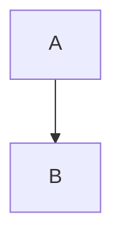
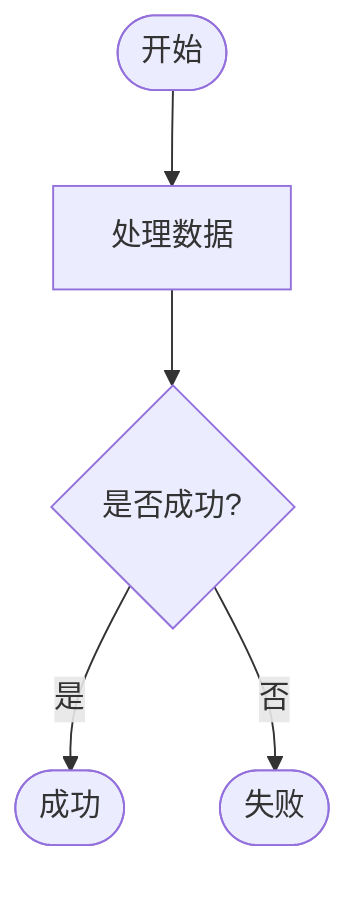
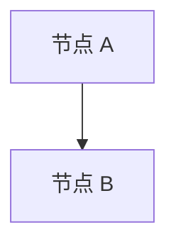
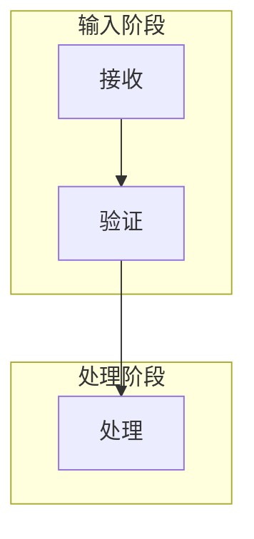
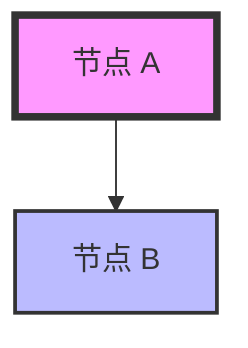
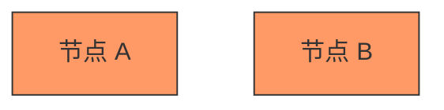

# Mermaid 图表常见问题解答 (FAQ)

## 目录

- [基础问题](#基础问题)
- [配置问题](#配置问题)
- [渲染问题](#渲染问题)
- [兼容性问题](#兼容性问题)
- [性能问题](#性能问题)
- [高级问题](#高级问题)

---

## 基础问题

### Q1: 什么是 Mermaid？

**A:** Mermaid 是一个基于 JavaScript 的图表和图形工具，它使用类似 Markdown 的文本语法来创建和修改图表。您可以用简单的文本代码创建流程图、时序图、类图等多种专业图表。

**优势：**
- 📝 文本即代码，易于版本控制
- 🎨 自动布局，无需手动调整
- 🔄 易于修改和维护
- 📱 响应式设计，自适应屏幕

---

### Q2: Argon 主题支持哪些 Mermaid 图表类型？

**A:** Argon 主题支持 Mermaid 的所有主要图表类型：

1. **流程图 (Flowchart)** - 展示流程和决策
2. **时序图 (Sequence Diagram)** - 描述对象交互
3. **类图 (Class Diagram)** - 展示类结构
4. **状态图 (State Diagram)** - 表示状态转换
5. **饼图 (Pie Chart)** - 显示数据占比
6. **甘特图 (Gantt Chart)** - 项目进度管理
7. **用户旅程图 (User Journey)** - 用户体验流程
8. **Git 图 (Git Graph)** - 版本控制可视化

详细示例请参考[用户指南](mermaid-user-guide.md#支持的图表类型)。

---

### Q3: 如何在文章中插入 Mermaid 图表？

**A:** 有三种方式：

**方式 1：标准 Markdown 代码块**（推荐）⭐
````markdown
三个反引号mermaid
flowchart TD
    A[开始] --> B[结束]
三个反引号
````

**优点：**
- ✅ 符合标准 Markdown 语法
- ✅ 在所有 Markdown 编辑器中都能正确显示
- ✅ 易于迁移到其他平台（GitHub、GitLab、Typora 等）
- ✅ 主题自动拦截处理，避免代码高亮干扰

**方式 2：Markdown 容器语法**（备选）
````markdown
::: mermaid
flowchart TD
    A[开始] --> B[结束]
:::
````

**优点：**
- ✅ 符合 Markdown 扩展规范（VuePress、Docusaurus 等）
- ✅ 不会被 WP-Markdown 当作代码块处理

**方式 3：Shortcode 格式**（兼容）
```
[mermaid]
flowchart TD
    A[开始] --> B[结束]
[/mermaid]
```

**优点：**
- ✅ WordPress 原生支持
- ✅ 兼容性最好

**缺点：**
- ❌ 不符合 Markdown 标准
- ❌ 在其他平台无法使用

---

### Q4: 为什么推荐使用标准 Markdown 代码块？

**A:** 因为标准 Markdown 代码块 (` ```mermaid `) 是最通用的方式：

- **GitHub** 使用这种语法
- **GitLab** 使用这种语法
- **Typora** 使用这种语法
- **VS Code** 使用这种语法
- **符合 CommonMark 规范**

Argon 主题通过**代码块魔改**技术，在代码高亮之前拦截并转换 mermaid 代码块，因此：
- ✅ 不会被代码高亮处理（无行号、无控制按钮）
- ✅ 不会有字符转义问题（`-->` 保持不变）
- ✅ 不会有嵌套结构问题
- ✅ 完全符合标准 Markdown 语法
- ✅ 易于迁移到其他平台

````

**方式 2：HTML 标签**
```html
<div class="mermaid">
flowchart TD
    A --> B
</div>
```

**注意：** 使用前需要在主题设置中启用 Mermaid 支持。

---

### Q4: 需要安装额外的插件吗？

**A:** 不需要。Argon 主题内置了 Mermaid 支持，开箱即用。

**但是：**
- 如果您已经安装了 Mermaid 相关插件（如 WP Githuber MD），主题会自动检测并避免重复加载
- 主题会智能判断是否需要加载 Mermaid 库

---

## 配置问题

### Q5: 如何启用 Mermaid 支持？

**A:** 按照以下步骤操作：

1. 登录 WordPress 后台
2. 进入 **外观 → Argon 主题设置**
3. 找到 **Mermaid 图表** 分类
4. 勾选 **"启用 Mermaid 支持"**
5. 点击 **"保存设置"**

---

### Q6: 应该选择哪个 CDN 来源？

**A:** 推荐选择：

**首选：jsDelivr CDN**
- ✅ 全球 CDN，速度快
- ✅ 稳定性高
- ✅ 免费使用

**备选：unpkg CDN**
- 作为备用选项

**特殊情况：**
- **内网环境** → 使用本地文件
- **特定版本需求** → 使用自定义 CDN
- **极致速度** → 下载本地文件

**主题优势：** 即使主 CDN 失败，主题会自动尝试备用 CDN，确保可用性。

---

### Q7: 如何使用自定义 CDN？

**A:** 步骤如下：

1. 在 **CDN 来源** 中选择 **"自定义 CDN 地址"**
2. 在 **自定义 CDN 地址** 输入框中填入完整的 URL
3. 保存设置

**URL 格式要求：**
- 必须是有效的 URL
- 必须以 `.js` 结尾
- 必须使用 `http://` 或 `https://` 协议

**示例：**
```
https://cdn.example.com/mermaid@10.0.0/mermaid.min.js
```

---

### Q8: 图表主题应该选择哪个？

**A:** 推荐选择 **"自动切换"**。

**原因：**
- 自动跟随页面的日间/夜间模式
- 日间模式使用浅色主题
- 夜间模式使用深色主题
- 用户体验最佳

**其他选项：**
- **默认主题** - 固定使用浅色
- **深色主题** - 固定使用深色
- **森林主题** - 绿色主题
- **中性主题** - 灰色主题

---

### Q9: 什么时候需要启用调试模式？

**A:** 在以下情况下启用：

1. **图表不显示** - 查看是否有加载错误
2. **渲染失败** - 查看详细的错误信息
3. **主题切换异常** - 检查主题切换逻辑
4. **CDN 加载问题** - 查看 CDN 加载状态
5. **开发测试** - 开发新功能时调试

**如何使用：**
1. 启用调试模式
2. 打开浏览器开发者工具（F12）
3. 切换到"控制台"标签
4. 查看以 `[Argon Mermaid]` 开头的日志

**注意：** 生产环境建议关闭调试模式。

---

## 渲染问题

### Q10: 图表不显示，只显示代码怎么办？

**A:** 按以下步骤排查：

**步骤 1：检查是否启用**
- 确认主题设置中已启用 Mermaid 支持

**步骤 2：检查代码格式**
- 确认使用了正确的代码块格式
- 检查是否有语法错误

**步骤 3：检查浏览器控制台**
- 按 F12 打开开发者工具
- 查看是否有 JavaScript 错误

**步骤 4：启用调试模式**
- 在主题设置中启用调试模式
- 查看详细的日志信息

**步骤 5：验证代码**
- 访问 [Mermaid Live Editor](https://mermaid.live/)
- 粘贴代码验证语法是否正确

---

### Q11: 图表显示"渲染失败"错误？

**A:** 这通常是代码语法错误导致的。

**解决方法：**

1. **查看错误详情**
   - 点击错误提示中的"查看原始代码"
   - 查看错误类型和错误信息

2. **常见语法错误：**
   - 缺少必要的关键字
   - 箭头符号错误
   - 节点 ID 重复
   - 引号不匹配
   - 缩进不正确

3. **使用在线编辑器验证**
   - 访问 [Mermaid Live Editor](https://mermaid.live/)
   - 粘贴代码并查看错误提示
   - 根据提示修正语法

4. **参考官方文档**
   - [Mermaid 语法参考](https://mermaid.js.org/intro/syntax-reference.html)
   - 查看对应图表类型的语法规则

---

### Q12: 图表在夜间模式下看不清？

**A:** 这是主题配置问题。

**解决方法：**

1. 进入 **主题设置 → Mermaid 图表 → 外观设置**
2. 将 **图表主题** 设置为 **"自动切换"**
3. 保存设置

**原理：**
- 自动切换模式会检测页面主题
- 日间模式使用浅色图表主题
- 夜间模式使用深色图表主题

**如果仍有问题：**
- 清除浏览器缓存
- 刷新页面
- 检查是否有其他 CSS 冲突

---

### Q13: 图表太大，超出容器怎么办？

**A:** Mermaid 图表会自动适应容器宽度，但如果图表过于复杂，可能会出现问题。

**解决方法：**

**方法 1：简化图表**
- 减少节点数量
- 拆分为多个小图表
- 使用子图组织内容

**方法 2：自定义样式**
```css
.mermaid-container {
    max-width: 100%;
    overflow-x: auto;
}

.mermaid-container svg {
    max-width: 100%;
    height: auto;
}
```

**方法 3：调整图表方向**
```mermaid
flowchart LR  /* 横向布局 */
    A --> B
```

```mermaid
flowchart TD  /* 纵向布局 */
    A --> B
```

---

### Q14: 如何在评论中使用 Mermaid？

**A:** 评论中需要使用 HTML 格式。

**步骤：**

1. **确保评论允许 HTML**
   - 检查 WordPress 评论设置
   - 确认允许使用 HTML 标签

2. **使用 HTML 格式**
```html
<div class="mermaid">
flowchart LR
    A --> B
</div>
```

3. **提交评论**
   - 评论会在前台自动渲染为图表

**注意：**
- 不能使用 Markdown 代码块格式
- 必须使用 `<div class="mermaid">` 包裹
- 代码需要正确的换行格式

---

## 兼容性问题

### Q15: 与其他插件冲突怎么办？

**A:** Argon 主题内置了智能兼容机制。

**自动检测的插件：**
- WP Githuber MD
- Markdown Block
- Code Syntax Block

**兼容策略：**
1. 主题会自动检测已安装的 Mermaid 插件
2. 如果检测到插件，主题只提供样式增强
3. 避免重复加载 Mermaid 库

**查看兼容性状态：**
1. 进入 **主题设置 → Mermaid 图表 → 高级选项**
2. 查看 **插件兼容性检测** 部分
3. 查看检测结果和建议

**如果仍有冲突：**
- 禁用主题的 Mermaid 支持，使用插件
- 或禁用插件，使用主题的 Mermaid 支持
- 不要同时启用多个 Mermaid 功能

---

### Q16: 检测到多个 Mermaid 插件怎么办？

**A:** 这会导致重复加载和冲突。

**建议：**
1. **只保留一个** - 选择功能最完善的插件
2. **或使用主题** - 禁用所有插件，使用主题的 Mermaid 支持

**如何选择：**
- **插件功能更多** → 禁用主题支持，使用插件
- **主题集成更好** → 禁用插件，使用主题支持
- **性能优先** → 使用主题支持（按需加载）

---

### Q17: 在不同编辑器中如何使用？

**A:** 不同编辑器使用方法略有不同。

**Gutenberg 编辑器：**
1. 添加"代码"块或"自定义 HTML"块
2. 输入 Mermaid 代码
3. 使用 `<div class="mermaid">` 包裹

**经典编辑器：**
1. 切换到"文本"模式
2. 使用 HTML 格式
3. 使用 `<div class="mermaid">` 包裹

**Markdown 编辑器（如 WP-Markdown）：**
1. 使用代码块语法
2. 指定语言为 `mermaid`
````markdown

````

**WP Githuber MD：**
- 插件自带 Mermaid 支持
- 主题会自动检测并避免冲突
- 使用插件的 Mermaid 功能即可

---

## 性能问题

### Q18: Mermaid 会影响页面加载速度吗？

**A:** 主题已做了充分的性能优化。

**优化措施：**

1. **按需加载**
   - 只在包含 Mermaid 代码的页面加载库
   - 没有 Mermaid 代码的页面不加载

2. **异步加载**
   - Mermaid 库使用 async 属性异步加载
   - 不阻塞页面渲染

3. **CDN 加速**
   - 使用全球 CDN 加速加载
   - 浏览器缓存减少重复加载

4. **智能检测**
   - 检测插件是否已加载库
   - 避免重复加载

**实际影响：**
- Mermaid 库大小约 300KB（gzip 后约 100KB）
- 首次加载约 0.5-1 秒
- 后续访问使用缓存，几乎无影响

---

### Q19: 一篇文章可以使用多少个图表？

**A:** 技术上没有限制，但建议控制数量。

**建议：**
- **小型图表** - 不超过 10 个
- **中型图表** - 不超过 5 个
- **大型图表** - 不超过 3 个

**原因：**
- 过多图表会增加渲染时间
- 影响页面性能
- 用户体验下降

**优化建议：**
1. 合并相关图表
2. 使用子图组织内容
3. 复杂图表考虑使用图片替代
4. 分页展示大量图表

---

### Q20: 如何优化 Mermaid 性能？

**A:** 以下是一些优化建议：

**1. 使用本地文件**
- 下载 Mermaid 库到主题目录
- 启用"使用本地镜像"
- 减少网络请求

**2. 简化图表**
- 减少节点数量
- 避免过于复杂的关系
- 使用简洁的文本

**3. 启用浏览器缓存**
- CDN 文件会自动缓存
- 减少重复加载

**4. 按需加载**
- 主题已自动实现
- 只在需要时加载库

**5. 使用 CDN**
- 利用 CDN 的全球加速
- 减少服务器负载

---

## 高级问题

### Q21: 如何自定义 Mermaid 样式？

**A:** 可以通过 CSS 自定义样式。

**方法 1：使用主题自定义 CSS**
1. 进入 **外观 → 自定义 → 额外 CSS**
2. 添加自定义样式

**示例：**
```css
/* 自定义图表容器样式 */
.mermaid-container {
    background: #f5f5f5;
    padding: 20px;
    border-radius: 8px;
    box-shadow: 0 2px 8px rgba(0,0,0,0.1);
}

/* 自定义错误提示样式 */
.mermaid-error-container {
    background: #fff3cd;
    border-left: 4px solid #ffc107;
}
```

**方法 2：修改主题文件**
- 编辑 `style.css`
- 在 Mermaid 相关部分添加样式
- 不推荐（主题更新会覆盖）

---

### Q22: 如何导出 Mermaid 图表为图片？

**A:** 有多种方法可以导出图表。

**方法 1：使用 Mermaid Live Editor**
1. 访问 [Mermaid Live Editor](https://mermaid.live/)
2. 粘贴代码
3. 点击"Export"按钮
4. 选择 PNG 或 SVG 格式

**方法 2：浏览器截图**
1. 在浏览器中打开文章
2. 使用截图工具截取图表
3. Windows: Win + Shift + S
4. Mac: Cmd + Shift + 4

**方法 3：开发者工具**
1. 右键点击图表 → 检查元素
2. 找到 SVG 元素
3. 右键 → Copy → Copy outerHTML
4. 保存为 .svg 文件
5. 使用工具转换为 PNG

**方法 4：使用插件**
- 安装浏览器截图插件
- 如 Awesome Screenshot
- 直接截取并保存

---

### Q23: 如何在 Mermaid 代码中使用中文？

**A:** Mermaid 完全支持中文，直接使用即可。

**示例：**


**注意事项：**
1. **引号问题**
   - 如果文本包含特殊字符，使用引号包裹
   - `A["包含特殊字符的文本"]`

2. **编码问题**
   - 确保文件编码为 UTF-8
   - WordPress 默认使用 UTF-8

3. **字体问题**
   - 确保浏览器支持中文字体
   - 现代浏览器都支持

---

### Q24: 如何在 Mermaid 中添加链接？

**A:** Mermaid 支持为节点添加链接。

**语法：**


**参数说明：**
- 第一个参数：节点 ID
- 第二个参数：链接 URL
- 第三个参数：提示文本或打开方式
  - `"提示文本"` - 鼠标悬停提示
  - `_blank` - 新标签页打开
  - `_self` - 当前标签页打开

---

### Q25: 如何使用 Mermaid 的高级功能？

**A:** Mermaid 支持许多高级功能。

**1. 子图 (Subgraph)**


**2. 样式定义**


**3. 类样式**


**4. 注释**
```mermaid
%% 这是注释，不会显示
flowchart TD
    A --> B  %% 行尾注释
```

**更多功能：**
- 查看 [Mermaid 官方文档](https://mermaid.js.org/)
- 参考各图表类型的详细语法

---

## 获取更多帮助

### 官方资源

- 📚 [Mermaid 官方文档](https://mermaid.js.org/)
- 🎨 [Mermaid Live Editor](https://mermaid.live/)
- 💬 [Mermaid GitHub](https://github.com/mermaid-js/mermaid)

### Argon 主题支持

- 🐛 [提交 Issue](https://github.com/solstice23/argon-theme/issues)
- 📖 [主题文档](https://github.com/solstice23/argon-theme)
- 💡 [用户指南](mermaid-user-guide.md)

### 社区资源

- 🌐 WordPress 论坛
- 💬 主题用户群
- 📝 技术博客和教程

---

**最后更新：** 2024-01-22  
**文档版本：** 1.0.0
