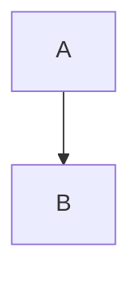

# Mermaid 支持方案对比

## 概述

Argon 主题现在支持多种 Mermaid 图表标记方式，每种方式都有其优缺点和适用场景。

---

## 方案对比表

| 方案 | 语法 | 优点 | 缺点 | 推荐度 | 适用场景 |
|------|------|------|------|--------|----------|
| **Shortcode** | `[mermaid]...[/mermaid]` | ✅ 最可靠<br>✅ 支持参数<br>✅ 不被格式化<br>✅ 易于编辑 | ❌ 需要记住语法 | ⭐⭐⭐⭐⭐ | **所有场景（推荐）** |
| 容器语法 | `::: mermaid ... :::` | ✅ 符合 Markdown 规范<br>✅ 易于迁移 | ❌ 被 WP 格式化<br>❌ 换行符问题<br>❌ 特殊字符转换 | ⭐⭐⭐ | 简单图表 |
| 代码块 | ` ```mermaid ... ``` ` | ✅ 通用语法<br>✅ 编辑器高亮 | ❌ 被代码高亮干扰<br>❌ 嵌套问题 | ⭐⭐ | 不推荐 |
| HTML | `<div class="mermaid">...</div>` | ✅ 灵活<br>✅ 完全控制 | ❌ 编辑不便<br>❌ 可读性差 | ⭐⭐ | 特殊需求 |

---

## 详细对比

### 1. Shortcode 方式 ⭐⭐⭐⭐⭐（推荐）

#### 语法
```
[mermaid theme="default" width="100%" align="center"]
flowchart TD
    A[开始] --> B[处理]
    B --> C[结束]
[/mermaid]
```

#### 优点
- ✅ **最可靠**：不依赖 WP-Markdown 的处理方式
- ✅ **不被破坏**：不会被 WordPress 自动格式化
- ✅ **支持参数**：theme、width、height、align
- ✅ **易于编辑**：在编辑器中清晰可见
- ✅ **完全兼容**：与其他 Shortcode 一样使用

#### 缺点
- ❌ 需要记住 Shortcode 语法
- ❌ 不是标准 Markdown 语法

#### 适用场景
- ✅ **所有场景**（强烈推荐）
- ✅ 复杂流程图
- ✅ 需要自定义样式
- ✅ 长期维护的文档

#### 示例
```
[mermaid theme="dark" width="80%"]
sequenceDiagram
    Alice->>Bob: Hello
    Bob-->>Alice: Hi
[/mermaid]
```

---

### 2. 容器语法 ⭐⭐⭐

#### 语法
```markdown
::: mermaid
flowchart TD
    A --> B
:::
```

#### 优点
- ✅ 符合 Markdown 扩展规范
- ✅ VuePress、Docusaurus 等使用相同语法
- ✅ 易于迁移到其他平台

#### 缺点
- ❌ **被 WordPress 格式化破坏**
  - `-->` 转换为 `–>`
  - 换行符可能丢失
  - 需要复杂的 JavaScript 处理
- ❌ 不支持参数配置
- ❌ 依赖 WP-Markdown 的处理方式

#### 适用场景
- ✅ 简单的流程图
- ✅ 不包含特殊字符
- ✅ 需要跨平台兼容

#### 注意事项
- ⚠️ 避免使用 `-->` 箭头（可能被转换）
- ⚠️ 避免复杂的多行文本
- ⚠️ 需要开启主题的 Mermaid 支持

---

### 3. 代码块方式 ⭐⭐

#### 语法
````markdown

````

#### 优点
- ✅ 通用的 Markdown 语法
- ✅ 编辑器可能提供语法高亮

#### 缺点
- ❌ **被代码高亮干扰**
  - Prism.js 会处理代码块
  - 可能出现嵌套问题
- ❌ 被 WP-Markdown 包裹在 `document.write()` 中
- ❌ 需要特殊处理排除

#### 适用场景
- ⚠️ **不推荐使用**
- 仅在其他方式不可用时考虑

#### 注意事项
- ⚠️ 需要在代码高亮中排除 mermaid
- ⚠️ 可能出现渲染冲突

---

### 4. HTML 方式 ⭐⭐

#### 语法
```html
<div class="mermaid">
flowchart TD
    A --> B
</div>
```

#### 优点
- ✅ 完全控制 HTML 结构
- ✅ 可以添加自定义属性

#### 缺点
- ❌ 编辑不便
- ❌ 可读性差
- ❌ 不符合 Markdown 风格

#### 适用场景
- ✅ 需要特殊的 HTML 结构
- ✅ 需要自定义 CSS 类
- ✅ 程序生成的内容

---

## 使用建议

### 新项目

**强烈推荐使用 Shortcode 方式**：

```
[mermaid]
flowchart TD
    A --> B
[/mermaid]
```

**理由**：
1. 最可靠，不会被破坏
2. 支持参数配置
3. 易于维护
4. 长期稳定

### 现有项目迁移

如果你已经使用了容器语法 `::: mermaid ... :::`：

#### 选项 1：保持不变（简单图表）
- 如果图表简单，没有特殊字符
- 如果渲染正常，无需修改

#### 选项 2：迁移到 Shortcode（推荐）
- 批量替换：`::: mermaid` → `[mermaid]`
- 批量替换：`:::` → `[/mermaid]`
- 测试验证

### 不同场景的选择

#### 场景 1：技术文档
**推荐**：Shortcode
- 需要长期维护
- 图表复杂
- 需要自定义样式

#### 场景 2：博客文章
**推荐**：Shortcode
- 简单易用
- 不需要记住复杂语法
- 稳定可靠

#### 场景 3：跨平台内容
**推荐**：容器语法（如果目标平台支持）
- 需要在多个平台发布
- 目标平台支持容器语法
- 可以接受一些限制

#### 场景 4：程序生成
**推荐**：HTML 或 Shortcode
- 由程序自动生成
- 需要批量处理
- 可以使用模板

---

## 性能对比

| 方案 | 渲染速度 | 内存占用 | 兼容性 | 稳定性 |
|------|----------|----------|--------|--------|
| Shortcode | ⭐⭐⭐⭐⭐ | ⭐⭐⭐⭐⭐ | ⭐⭐⭐⭐⭐ | ⭐⭐⭐⭐⭐ |
| 容器语法 | ⭐⭐⭐⭐ | ⭐⭐⭐⭐ | ⭐⭐⭐ | ⭐⭐⭐ |
| 代码块 | ⭐⭐⭐ | ⭐⭐⭐ | ⭐⭐ | ⭐⭐ |
| HTML | ⭐⭐⭐⭐⭐ | ⭐⭐⭐⭐⭐ | ⭐⭐⭐⭐ | ⭐⭐⭐⭐ |

---

## 常见问题

### Q1: 为什么推荐 Shortcode 而不是容器语法？

**A**: 容器语法虽然符合 Markdown 规范，但在 WordPress 环境下会遇到以下问题：
1. WordPress 的 `wptexturize()` 会转换特殊字符
2. WP-Markdown 的处理方式不一致
3. 需要复杂的 JavaScript 来修复这些问题

Shortcode 方式完全避免了这些问题，更加可靠。

### Q2: 可以混用多种方式吗？

**A**: 可以，但不推荐。建议统一使用一种方式，便于维护。

### Q3: 如何批量迁移到 Shortcode？

**A**: 使用 WordPress 的搜索替换功能：
1. 安装 "Better Search Replace" 插件
2. 搜索：`::: mermaid`，替换为：`[mermaid]`
3. 搜索：`:::`（在 mermaid 代码块后），替换为：`[/mermaid]`
4. 测试验证

### Q4: Shortcode 支持哪些参数？

**A**: 
- `theme`: 主题（default, dark, forest, neutral）
- `width`: 宽度（100%, 80%, 600px 等）
- `height`: 高度（auto, 500px 等）
- `align`: 对齐（left, center, right）

### Q5: 容器语法还会继续支持吗？

**A**: 会继续支持，但不推荐新项目使用。我们会持续修复容器语法的问题，但 Shortcode 是更好的选择。

---

## 技术实现对比

### Shortcode 实现

**PHP 端**（functions.php）：
```php
add_shortcode('mermaid','shortcode_mermaid');
function shortcode_mermaid($attr,$content=""){
	$content = shortcode_content_preprocess($attr, $content);
	$theme = isset( $attr['theme'] ) ? $attr['theme'] : 'default';
	// ... 生成 HTML
	return $out;
}
```

**JavaScript 端**（argontheme.js）：
```javascript
const selectors = [
	'div.mermaid-shortcode',  // 直接检测
	// ...
];
```

**优点**：
- ✅ 简单直接
- ✅ 不需要复杂的解析
- ✅ 性能最优

### 容器语法实现

**JavaScript 端**（argontheme.js）：
```javascript
// 1. 检测容器语法
detectContainerBlocks(blocks);

// 2. 提取内容
extractContainerContent(startElement, processedElements);

// 3. 转换 HTML
htmlToText(html);

// 4. 修复特殊字符
text.replace(/–/g, '-');
```

**缺点**：
- ❌ 需要复杂的 DOM 遍历
- ❌ 需要处理多种 HTML 结构
- ❌ 需要修复 WordPress 的格式化
- ❌ 性能开销较大

---

## 总结

### 推荐方案

1. **首选**：Shortcode 方式 `[mermaid]...[/mermaid]`
   - 最可靠、最稳定
   - 支持参数配置
   - 易于维护

2. **备选**：容器语法 `::: mermaid ... :::`
   - 简单图表可用
   - 跨平台兼容
   - 需要注意限制

3. **不推荐**：代码块和 HTML 方式
   - 仅在特殊情况下使用

### 迁移建议

- ✅ 新项目：直接使用 Shortcode
- ✅ 现有项目：逐步迁移到 Shortcode
- ✅ 简单图表：可以保持容器语法

### 文档链接

- [Shortcode 使用指南](./mermaid-shortcode-guide.md)
- [容器语法使用指南](./mermaid-usage-guide.md)
- [修复总结](./mermaid-fix-summary.md)
- [开发者指南](./mermaid-developer-guide.md)

---

**最后更新**：2026-01-24  
**版本**：Argon v2.x
