# Argon 主题 Mermaid 图表使用指南

## 目录

1. [功能简介](#功能简介)
2. [快速开始](#快速开始)
3. [支持的图表类型](#支持的图表类型)
4. [使用方法](#使用方法)
5. [主题设置](#主题设置)
6. [常见问题](#常见问题)
7. [最佳实践](#最佳实践)
8. [故障排除](#故障排除)

---

## 功能简介

Argon 主题内置了 Mermaid 图表支持，让您可以在文章中轻松创建各种专业的图表，包括：

- 📊 **流程图** - 展示业务流程和逻辑关系
- 📈 **时序图** - 描述系统交互和时间顺序
- 🏗️ **类图** - 展示面向对象的类结构
- 📉 **状态图** - 表示状态机和状态转换
- 🥧 **饼图** - 显示数据占比
- 📅 **甘特图** - 项目进度管理
- 🗺️ **用户旅程图** - 用户体验流程
- 🌳 **Git 图** - 版本控制分支可视化

### 主要特性

✅ **零配置使用** - 开箱即用，无需额外插件  
✅ **自动主题切换** - 跟随页面日间/夜间模式  
✅ **智能加载** - 只在需要时加载库文件  
✅ **插件兼容** - 自动检测并避免重复加载  
✅ **错误提示** - 友好的错误信息和调试支持  
✅ **CDN 降级** - 多个 CDN 自动切换，确保可用性  

---

## 快速开始

### 1. 启用 Mermaid 支持

进入 **WordPress 后台 → 外观 → Argon 主题设置 → Mermaid 图表**，勾选"启用 Mermaid 支持"。

### 2. 在文章中使用

在文章编辑器中，使用以下格式插入 Mermaid 代码：

````markdown
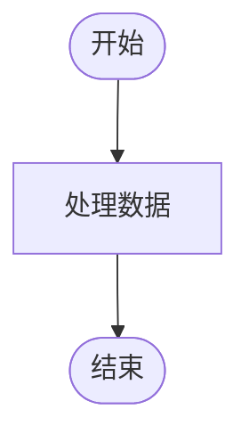
````

或使用 HTML 格式：

```html
<div class="mermaid">
flowchart TD
    Start([开始]) --> Process[处理数据]
    Process --> End([结束])
</div>
```

### 3. 发布并查看

保存文章后，在前台页面即可看到渲染后的图表。

---

## 支持的图表类型

### 1. 流程图 (Flowchart)

展示流程和决策逻辑。

````markdown
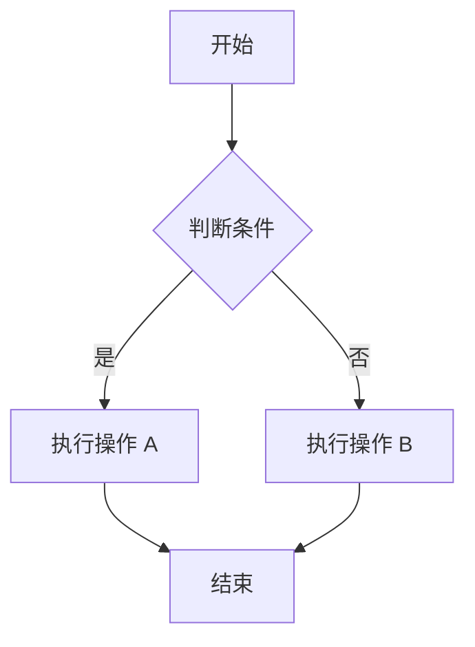
````

**节点形状：**
- `[文本]` - 矩形
- `([文本])` - 圆角矩形
- `{文本}` - 菱形（判断）
- `((文本))` - 圆形
- `[[文本]]` - 子程序

### 2. 时序图 (Sequence Diagram)

描述对象之间的交互顺序。

````markdown
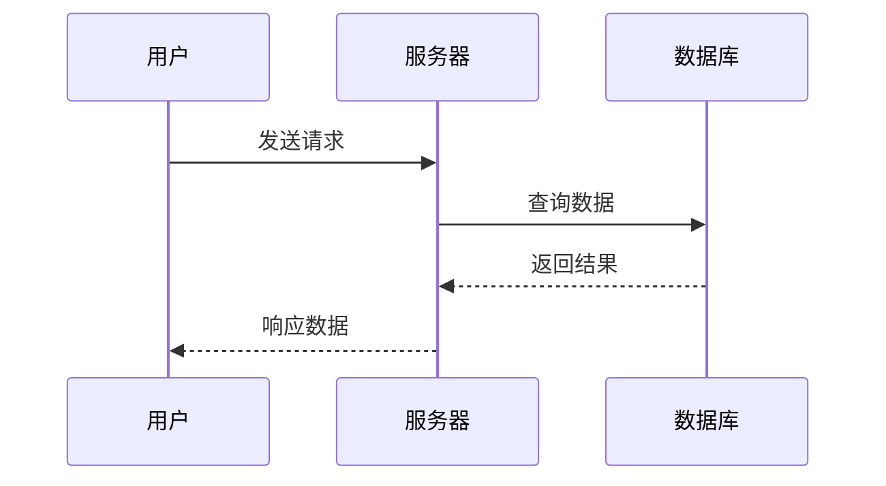
````

**箭头类型：**
- `->` - 实线箭头
- `-->` - 虚线箭头
- `->>` - 实线箭头（带箭头）
- `-->>` - 虚线箭头（带箭头）

### 3. 类图 (Class Diagram)

展示面向对象的类结构。

````markdown
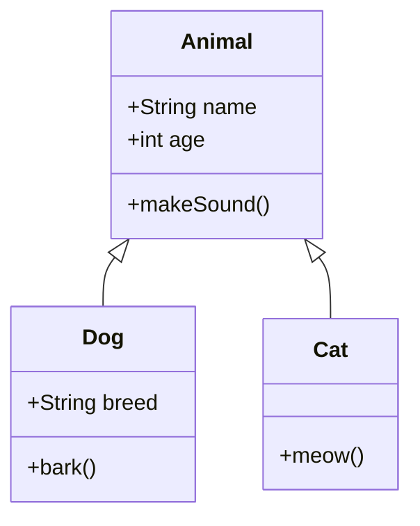
````

### 4. 状态图 (State Diagram)

表示状态机和状态转换。

````markdown
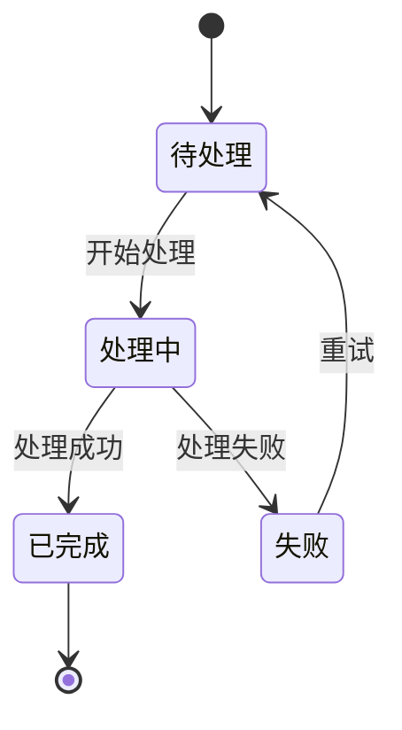
````

### 5. 饼图 (Pie Chart)

显示数据占比。

````markdown
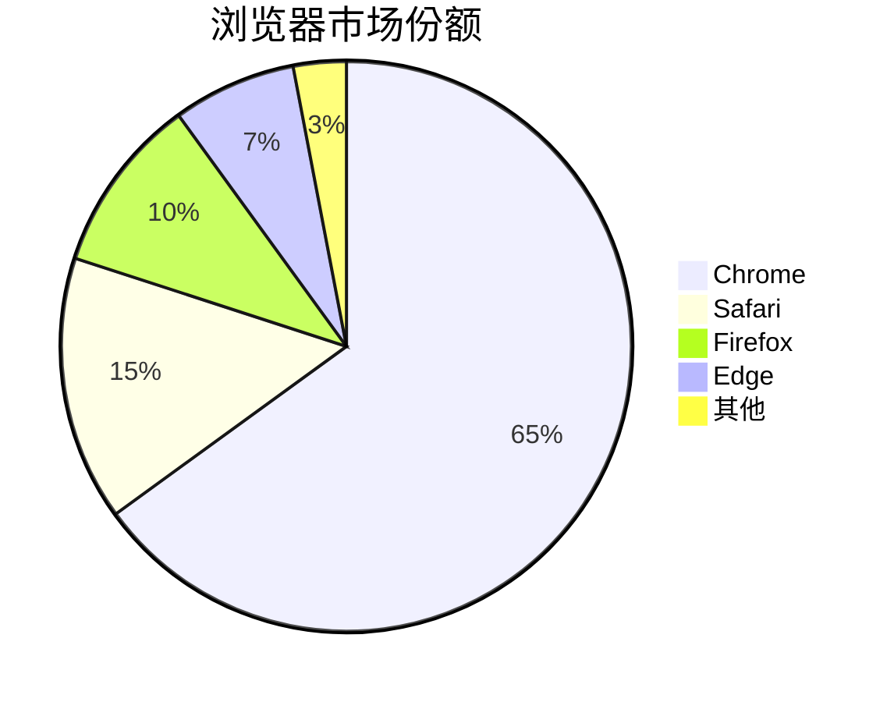
````

### 6. 甘特图 (Gantt Chart)

项目进度管理。

````markdown
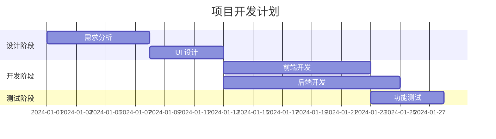
````

### 7. 用户旅程图 (User Journey)

描述用户体验流程。

````markdown
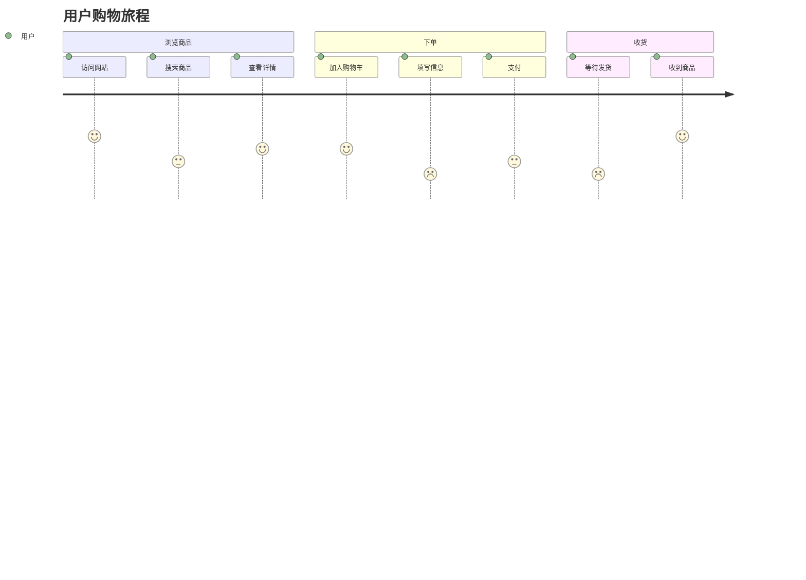
````

### 8. Git 图 (Git Graph)

版本控制分支可视化。

````markdown
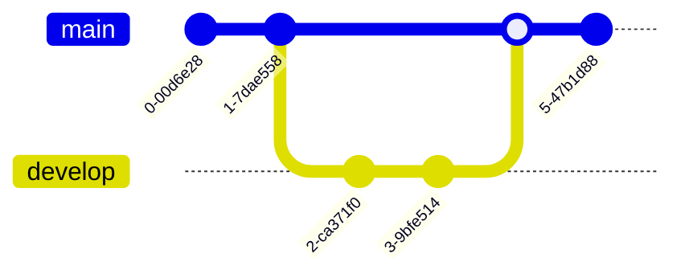
````

---

## 使用方法

### 在 Markdown 编辑器中使用

如果您使用 Markdown 编辑器（如 WP-Markdown），直接使用代码块语法：

````markdown
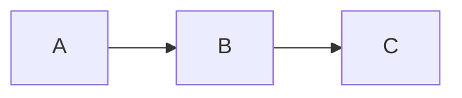
````

### 在 Gutenberg 编辑器中使用

1. 添加"代码"块或"自定义 HTML"块
2. 输入 Mermaid 代码
3. 使用 `<div class="mermaid">` 包裹

```html
<div class="mermaid">
flowchart LR
    A --> B
    B --> C
</div>
```

### 在经典编辑器中使用

切换到"文本"模式，使用 HTML 格式：

```html
<div class="mermaid">
flowchart LR
    A --> B
    B --> C
</div>
```

---

## 主题设置

### 基本设置

#### 启用 Mermaid 支持

**位置：** Argon 主题设置 → Mermaid 图表 → 基本设置

勾选此选项以启用 Mermaid 图表渲染功能。

#### CDN 来源

选择 Mermaid 库的加载来源：

- **jsDelivr CDN** (推荐) - 全球 CDN，速度快，稳定性高
- **unpkg CDN** - 备用 CDN
- **自定义 CDN 地址** - 使用自己的 CDN 或镜像
- **本地文件** - 使用主题目录中的本地文件

**建议：** 使用 jsDelivr CDN，主题会自动在多个 CDN 之间切换以确保可用性。

#### 自定义 CDN 地址

当选择"自定义 CDN 地址"时，输入完整的 Mermaid 库 URL。

**格式要求：**
- 必须是有效的 URL
- 必须以 `.js` 结尾
- 必须使用 `http://` 或 `https://` 协议

**示例：**
```
https://cdn.example.com/mermaid@10.0.0/mermaid.min.js
```

### 外观设置

#### 图表主题

选择 Mermaid 图表的配色主题：

- **自动切换** (推荐) - 跟随页面日间/夜间模式自动切换
- **默认主题** - 浅色主题，适合日间模式
- **深色主题** - 深色主题，适合夜间模式
- **森林主题** - 绿色主题
- **中性主题** - 灰色主题

**建议：** 使用"自动切换"，让图表主题与页面主题保持一致。

### 高级选项

#### 使用本地镜像

启用后，如果检测到主题目录中存在 Mermaid 库文件，将优先使用本地文件而不是 CDN。

**本地文件路径：**
```
wp-content/themes/argon/assets/vendor/mermaid/mermaid.min.js
```

**适用场景：**
- 内网环境无法访问外部 CDN
- 需要使用特定版本的 Mermaid
- 追求极致的加载速度

#### 调试模式

启用后，将在浏览器控制台输出详细的 Mermaid 渲染日志。

**日志内容包括：**
- 初始化状态
- 检测到的代码块数量
- 渲染成功/失败信息
- 主题切换记录
- CDN 加载状态

**使用方法：**
1. 启用调试模式
2. 打开浏览器开发者工具（F12）
3. 切换到"控制台"标签
4. 查看以 `[Argon Mermaid]` 开头的日志

#### 插件兼容性检测

主题会自动检测已安装的 Mermaid 插件，避免重复加载库文件。

**支持的插件：**
- WP Githuber MD
- Markdown Block
- Code Syntax Block

**兼容策略：**
- 如果检测到插件，主题将只提供样式增强
- 如果未检测到插件，主题将负责加载 Mermaid 库
- 如果检测到多个插件，会显示警告信息

---

## 常见问题

### Q1: 图表不显示，只显示代码？

**可能原因：**
1. 未启用 Mermaid 支持
2. 代码格式不正确
3. JavaScript 加载失败

**解决方法：**
1. 检查主题设置中是否启用了 Mermaid 支持
2. 确认代码格式正确（参考本文档示例）
3. 打开浏览器控制台查看是否有错误信息
4. 启用调试模式查看详细日志

### Q2: 图表显示"渲染失败"错误？

**可能原因：**
1. Mermaid 代码语法错误
2. 使用了不支持的图表类型
3. 代码格式不符合规范

**解决方法：**
1. 检查代码语法是否正确
2. 使用 [Mermaid Live Editor](https://mermaid.live/) 验证代码
3. 查看错误提示中的详细信息
4. 参考本文档中的示例代码

### Q3: 图表在夜间模式下看不清？

**解决方法：**
1. 进入主题设置 → Mermaid 图表 → 外观设置
2. 将"图表主题"设置为"自动切换"
3. 图表会自动跟随页面主题切换

### Q4: CDN 加载失败怎么办？

**主题已内置降级机制：**
1. 主 CDN 失败时，自动尝试备用 CDN
2. 所有 CDN 都失败时，显示友好的错误提示

**手动解决：**
1. 切换到其他 CDN 来源
2. 使用自定义 CDN 地址
3. 下载本地文件并启用"使用本地镜像"

### Q5: 与其他插件冲突？

**主题已内置兼容机制：**
- 自动检测已安装的 Mermaid 插件
- 避免重复加载库文件
- 只提供样式增强功能

**如果仍有冲突：**
1. 查看插件兼容性检测结果
2. 禁用主题的 Mermaid 支持，使用插件
3. 或禁用插件，使用主题的 Mermaid 支持

### Q6: 如何在评论中使用 Mermaid？

**方法：**
1. 评论中使用 HTML 格式
2. 使用 `<div class="mermaid">` 包裹代码

**示例：**
```html
<div class="mermaid">
flowchart LR
    A --> B
</div>
```

**注意：** 需要确保评论允许 HTML 标签。

### Q7: 图表太大，超出容器？

**解决方法：**
1. Mermaid 图表会自动适应容器宽度
2. 如果图表过于复杂，考虑简化或拆分
3. 使用 CSS 自定义样式调整大小

**自定义样式示例：**
```css
.mermaid-container {
    max-width: 100%;
    overflow-x: auto;
}
```

### Q8: 如何导出图表为图片？

**方法 1：使用浏览器截图**
1. 在浏览器中打开文章
2. 使用截图工具截取图表部分

**方法 2：使用 Mermaid Live Editor**
1. 访问 [Mermaid Live Editor](https://mermaid.live/)
2. 粘贴代码
3. 点击"Export"导出为 PNG/SVG

**方法 3：使用浏览器开发者工具**
1. 右键点击图表 → 检查元素
2. 找到 SVG 元素
3. 复制 SVG 代码或导出为图片

---

## 最佳实践

### 1. 代码格式规范

**推荐：**
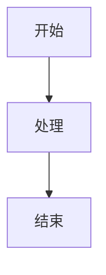

**不推荐：**


**建议：**
- 使用缩进保持代码可读性
- 箭头两侧添加空格
- 每行一个语句

### 2. 节点命名

**推荐：**


**不推荐：**
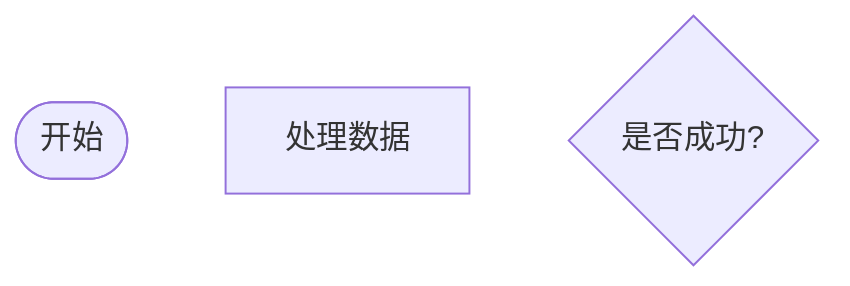

**建议：**
- 使用有意义的节点 ID
- 节点文本简洁明了
- 避免使用特殊字符

### 3. 图表复杂度

**建议：**
- 单个图表不超过 20 个节点
- 复杂流程拆分为多个图表
- 使用子图组织相关节点

**示例：**
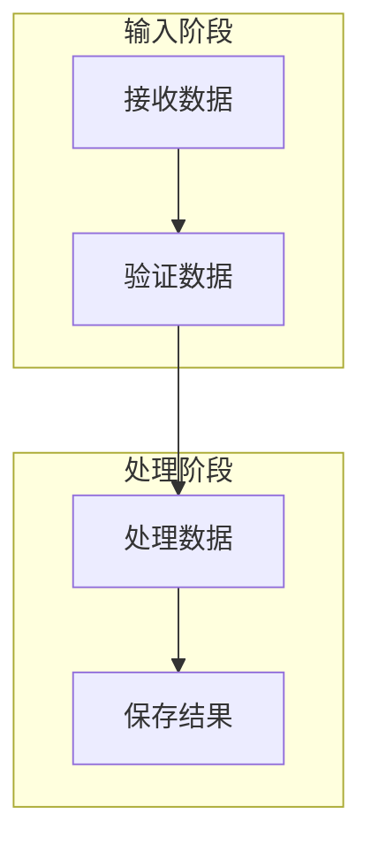

### 4. 性能优化

**建议：**
- 避免在一篇文章中使用过多图表（建议不超过 10 个）
- 复杂图表考虑使用图片替代
- 启用 CDN 加速加载

### 5. 可访问性

**建议：**
- 为图表添加文字说明
- 使用清晰的节点文本
- 避免仅依赖颜色传达信息

**示例：**
```html
<div class="mermaid-wrapper">
    <p>以下是用户注册流程图：</p>
    <div class="mermaid">
    flowchart TD
        Start([用户访问注册页]) --> Input[填写信息]
        Input --> Validate{验证信息}
        Validate -->|通过| Register[注册成功]
        Validate -->|失败| Input
    </div>
</div>
```

### 6. 版本控制

**建议：**
- 在文章中记录 Mermaid 代码版本
- 复杂图表保存源代码备份
- 使用注释说明图表用途

**示例：**
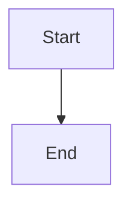

---

## 故障排除

### 调试步骤

1. **启用调试模式**
   - 进入主题设置 → Mermaid 图表 → 高级选项
   - 勾选"启用调试模式"

2. **打开浏览器控制台**
   - 按 F12 打开开发者工具
   - 切换到"控制台"标签

3. **查看日志信息**
   - 查找以 `[Argon Mermaid]` 开头的日志
   - 记录错误信息和警告

4. **验证代码语法**
   - 访问 [Mermaid Live Editor](https://mermaid.live/)
   - 粘贴代码并检查是否有语法错误

5. **检查网络请求**
   - 在开发者工具中切换到"网络"标签
   - 查看 Mermaid 库是否成功加载
   - 检查是否有 404 或其他错误

### 常见错误代码

#### 错误 1: Parse error on line X

**原因：** Mermaid 代码语法错误

**解决：**
1. 检查代码语法是否正确
2. 使用 Mermaid Live Editor 验证
3. 参考官方文档修正语法

#### 错误 2: Mermaid 库未加载

**原因：** CDN 加载失败或被阻止

**解决：**
1. 检查网络连接
2. 切换到其他 CDN 来源
3. 使用本地文件

#### 错误 3: 主题切换失败

**原因：** 配置错误或 JavaScript 冲突

**解决：**
1. 检查主题设置是否正确
2. 禁用其他可能冲突的插件
3. 清除浏览器缓存

### 获取帮助

如果以上方法都无法解决问题，请：

1. **收集信息：**
   - WordPress 版本
   - Argon 主题版本
   - 浏览器类型和版本
   - 错误信息和日志
   - 问题复现步骤

2. **提交问题：**
   - 访问 [Argon 主题 GitHub](https://github.com/solstice23/argon-theme/issues)
   - 创建新 Issue
   - 提供详细的问题描述和信息

3. **社区支持：**
   - 访问主题官方论坛
   - 搜索类似问题
   - 向社区求助

---

## 相关资源

### 官方文档

- [Mermaid 官方文档](https://mermaid.js.org/)
- [Mermaid 语法参考](https://mermaid.js.org/intro/syntax-reference.html)
- [Mermaid Live Editor](https://mermaid.live/)

### 教程和示例

- [Mermaid 快速入门](https://mermaid.js.org/intro/getting-started.html)
- [流程图教程](https://mermaid.js.org/syntax/flowchart.html)
- [时序图教程](https://mermaid.js.org/syntax/sequenceDiagram.html)
- [类图教程](https://mermaid.js.org/syntax/classDiagram.html)

### 工具和插件

- [Mermaid Chart](https://www.mermaidchart.com/) - 在线图表编辑器
- [VS Code Mermaid 插件](https://marketplace.visualstudio.com/items?itemName=bierner.markdown-mermaid)
- [Chrome Mermaid 扩展](https://chrome.google.com/webstore/search/mermaid)

---

## 更新日志

### 版本 1.0.0 (2024-01-22)

- ✨ 初始版本发布
- ✅ 支持所有主要图表类型
- ✅ 自动主题切换
- ✅ 插件兼容性检测
- ✅ CDN 降级机制
- ✅ 错误提示和调试支持

---

## 反馈与建议

如果您在使用过程中有任何问题或建议，欢迎：

- 📧 发送邮件至主题作者
- 💬 在 GitHub 上提交 Issue
- 🌟 为项目点赞支持

感谢您使用 Argon 主题！
