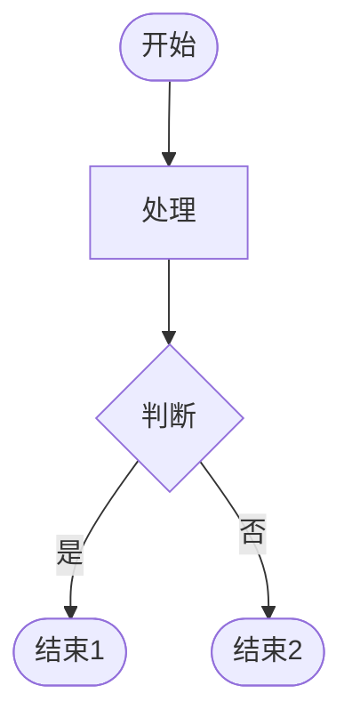
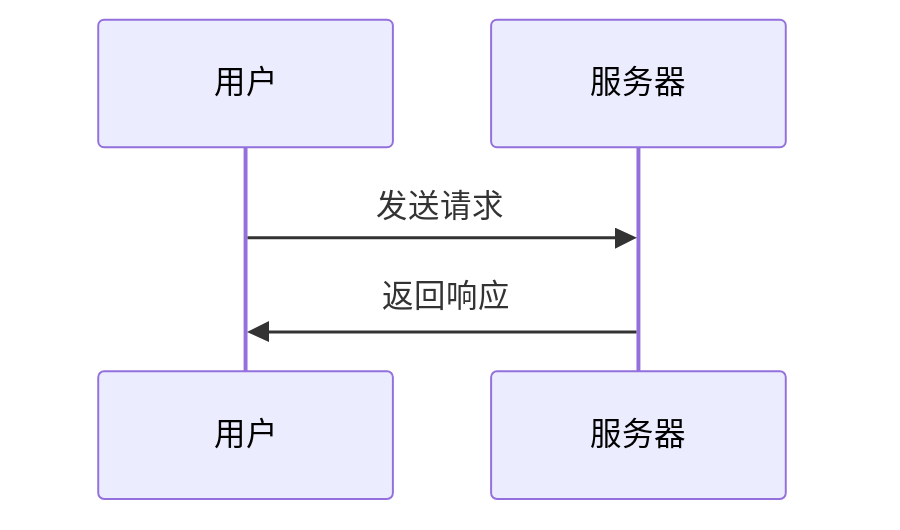
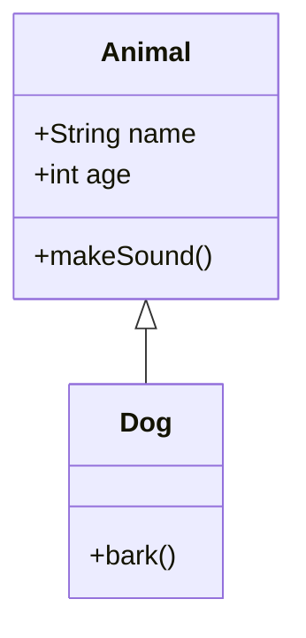

# Argon 主题 Mermaid 图表支持需求文档

## 需求背景

用户希望在 Argon WordPress 主题中添加 Mermaid 图表支持，以便在文章中使用流程图、时序图等可视化图表。

## 技术环境

- **WordPress 主题**: Argon
- **Markdown 编辑器**: WP-Markdown (wdmd) - 注意：这是编辑器，不是插件
- **Mermaid 版本**: 10.x 或更高

## 核心问题

### 1. WP-Markdown 渲染格式特殊

WP-Markdown 编辑器渲染 Mermaid 代码块时，生成的 HTML 格式为：

```html
<div class="mermaid">
    <script>document.write("flowchart TD\n Start --> End")</script>
    flowchart TD Start --> End
</div>
```

特点：
- 使用 `<div class="mermaid">` 包裹
- 内部包含 `<script>` 标签，使用 `document.write()` 输出转义后的代码
- 转义字符包括：`\n`（换行）、`\"`（引号）、`\'`（单引号）
- script 标签后还有原始文本（未转义）

### 2. Markdown 源文件格式问题

**关键问题**：用户在 WP-Markdown 编辑器中编辑时，虽然界面显示有换行（编辑器自动换行），但保存到 Markdown 源文件时，**整个 Mermaid 代码块是一整行，没有真正的换行符**。

示例：
```markdown
```mermaid
flowchart TD Start([用户提交评论]) --> PreProcess[preprocess_comment 钩子] PreProcess --> CheckEnabled{启用 AI 检测?} CheckEnabled -->|否| SaveComment[保存评论]
```
```

这导致：
- Mermaid 解析器要求代码有正确的换行格式
- 持续报错：`Parse error on line 1: Expecting 'NEWLINE', 'SPACE', 'GRAPH'`
- 所有尝试在 JavaScript 或 PHP 端添加换行的方案都失败

### 3. 已尝试的解决方案（均失败）

#### 方案 1: JavaScript 端解码
- 从 script 标签提取代码
- 解码 `\n` 为真正的换行符
- **失败原因**：Markdown 源文件中就没有 `\n`，只是一整行

#### 方案 2: 使用 mermaid.render()
- 替代 `mermaid.init()` 方法
- 手动渲染并插入 SVG
- **失败原因**：解析器仍然要求正确的换行格式

#### 方案 3: PHP 端预处理
- 在 `functions.php` 中添加 `argon_format_mermaid_code()` 函数
- 使用正则表达式在箭头、关键字前添加换行
- **失败原因**：无法准确判断应该在哪里添加换行

#### 方案 4: 智能检测单行代码
- 检测前 100 个字符中的换行符数量
- 如果少于 2 个，自动格式化
- **失败原因**：格式化规则不完善，仍然解析失败

## 需求分析

### 必要条件

要成功支持 Mermaid，需要满足以下条件之一：

1. **修改 WP-Markdown 编辑器**
   - 保存时保留真正的换行符
   - 或者在保存前格式化 Mermaid 代码块
   - **难度**：需要修改编辑器源码，可能影响其他功能

2. **使用支持 Mermaid 的 WordPress 插件**
   - 例如：WP Githuber MD、Markdown Block 等
   - 这些插件原生支持 Mermaid
   - **难度**：需要更换编辑器，用户可能不愿意

3. **开发完整的 Mermaid 代码格式化器**
   - 能够智能识别 Mermaid 语法
   - 自动添加正确的换行符
   - **难度**：需要深入理解 Mermaid 语法规则，工作量大

### 功能需求

如果要实现 Mermaid 支持，应包含以下功能：

#### 1. 基础功能
- [ ] 支持 Mermaid 所有图表类型（流程图、时序图、类图等）
- [ ] 响应式设计，图表自适应容器宽度
- [ ] 支持夜间模式，自动切换图表主题
- [ ] 支持本地镜像和 CDN 两种加载方式

#### 2. 设置选项
- [ ] 启用/禁用 Mermaid 支持
- [ ] 选择 CDN 地址（jsDelivr、unpkg、自定义）
- [ ] 选择图表主题（default、dark、forest、neutral 等）
- [ ] 是否使用本地镜像

#### 3. 样式优化
- [ ] 图表容器样式（背景、圆角、阴影）
- [ ] 夜间模式适配
- [ ] 移动端响应式
- [ ] 横向滚动支持（超宽图表）

#### 4. 错误处理
- [ ] 解析失败时显示友好的错误信息
- [ ] 在控制台输出详细的调试信息
- [ ] 提供代码预览功能

## 推荐方案

### 方案 A: 使用支持 Mermaid 的插件（推荐）

**优点**：
- 开箱即用，无需开发
- 插件维护者会持续更新
- 兼容性好，经过大量用户测试

**推荐插件**：
1. **WP Githuber MD** - 功能强大的 Markdown 编辑器
2. **Markdown Block** - Gutenberg 原生 Markdown 块
3. **Code Syntax Block** - 支持 Mermaid 的代码块插件

**实施步骤**：
1. 安装并激活插件
2. 在插件设置中启用 Mermaid 支持
3. 测试各种图表类型
4. 根据需要调整样式

### 方案 B: 要求用户手动格式化代码

**优点**：
- 无需修改主题代码
- 用户完全控制代码格式

**缺点**：
- 用户体验差
- 容易出错

**实施步骤**：
1. 在主题文档中说明 Mermaid 代码必须有正确的换行
2. 提供代码格式化工具或在线编辑器链接
3. 用户在外部工具中编辑好后，复制到 WordPress

### 方案 C: 开发完整的格式化器（不推荐）

**优点**：
- 用户体验好，自动处理

**缺点**：
- 开发工作量大
- 需要维护 Mermaid 语法规则
- 可能出现边缘情况无法处理

**实施步骤**：
1. 研究 Mermaid 完整语法规则
2. 开发智能格式化算法
3. 处理各种边缘情况
4. 大量测试

## 技术实现参考

### 标准 Mermaid 集成方式

```html
<!-- 加载 Mermaid 库 -->
<script src="https://cdn.jsdelivr.net/npm/mermaid@10/dist/mermaid.min.js"></script>

<!-- 初始化 -->
<script>
mermaid.initialize({
    startOnLoad: true,
    theme: 'default',
    securityLevel: 'loose'
});
</script>

<!-- 使用 -->
<div class="mermaid">
flowchart TD
    Start --> End
</div>
```

### WordPress 插件集成方式

```php
// 注册 Mermaid 脚本
function my_theme_enqueue_mermaid() {
    if (is_single() || is_page()) {
        wp_enqueue_script(
            'mermaid',
            'https://cdn.jsdelivr.net/npm/mermaid@10/dist/mermaid.min.js',
            [],
            '10.0.0',
            true
        );
    }
}
add_action('wp_enqueue_scripts', 'my_theme_enqueue_mermaid');

// 初始化脚本
function my_theme_mermaid_init() {
    ?>
    <script>
    document.addEventListener('DOMContentLoaded', function() {
        mermaid.initialize({
            startOnLoad: true,
            theme: '<?php echo get_option('mermaid_theme', 'default'); ?>'
        });
    });
    </script>
    <?php
}
add_action('wp_footer', 'my_theme_mermaid_init');
```

## 测试用例

### 测试 1: 基础流程图


### 测试 2: 时序图


### 测试 3: 类图


## 相关资源

- [Mermaid 官方文档](https://mermaid.js.org/)
- [Mermaid Live Editor](https://mermaid.live/) - 在线编辑器
- [WP Githuber MD 插件](https://wordpress.org/plugins/wp-githuber-md/)
- [Markdown Block 插件](https://wordpress.org/plugins/markdown-block/)

## 结论

由于 WP-Markdown 编辑器的特殊渲染方式和 Markdown 源文件格式问题，在 Argon 主题中直接支持 Mermaid 存在技术障碍。

**建议**：
1. **短期方案**：使用支持 Mermaid 的 WordPress 插件（如 WP Githuber MD）
2. **长期方案**：等待 WP-Markdown 编辑器更新，或考虑更换为更现代的 Markdown 编辑器

如果必须在当前环境下实现，需要投入大量时间开发完整的 Mermaid 代码格式化器，且无法保证 100% 兼容所有语法。
