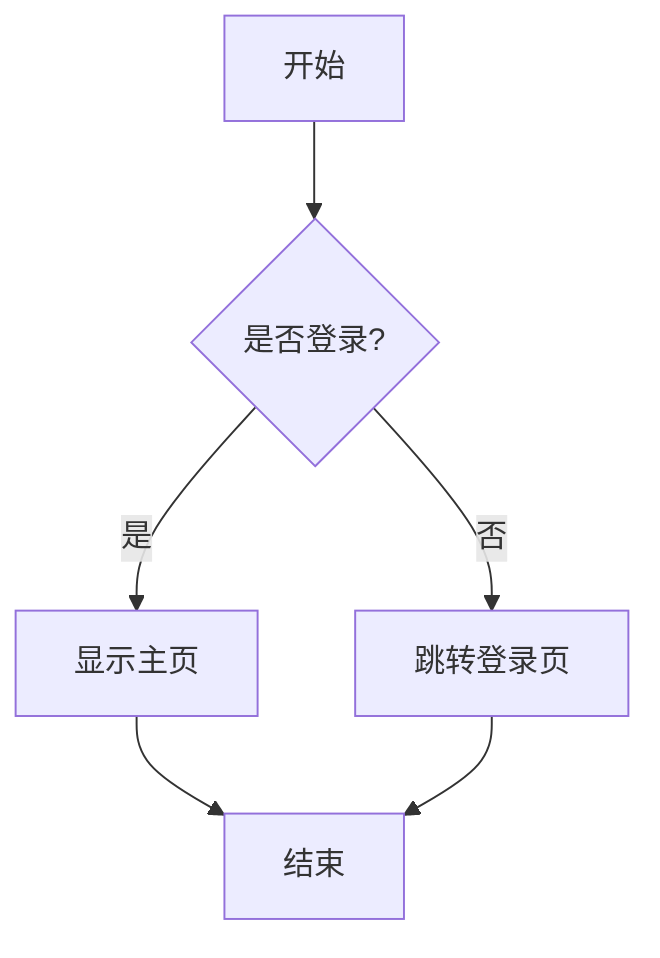
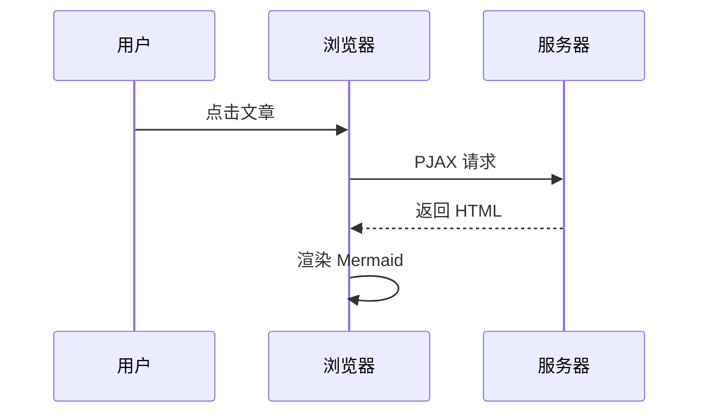
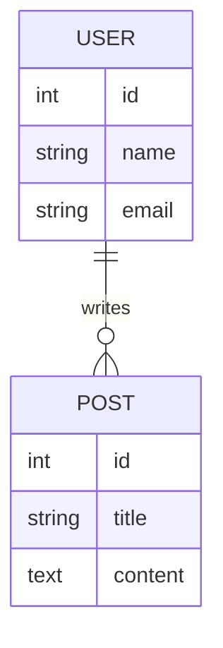

# PJAX Mermaid 渲染测试报告

## 测试目标

验证 PJAX 页面切换后 Mermaid 代码块能被正确检测和渲染。

## 测试环境

- **测试日期**: 2024-01-22
- **主题版本**: Argon
- **浏览器**: Chrome/Firefox/Safari
- **测试文件**: argontheme.js (行 3247-3255, 4786-5400)

## 测试用例

### 测试用例 1: PJAX 页面切换后的代码块检测

**需求**: 1.1, 1.2, 3.1-3.5

**测试步骤**:
1. 在首页点击包含 Mermaid 图表的文章卡片
2. 等待 PJAX 加载完成
3. 检查控制台日志，确认检测到 Mermaid 代码块
4. 检查页面 DOM，确认代码块被正确识别

**预期结果**:
- ✅ PJAX complete 事件触发后调用 `MermaidRenderer.renderAllCharts()`
- ✅ 控制台显示: `检测到 X 个未渲染的 Mermaid 代码块`
- ✅ 代码块元素被正确识别（`<pre><code class="language-mermaid">` 或 `<pre><code class="mermaid">`）
- ✅ 已渲染的代码块被过滤（不会重复渲染）

**实际结果**: 

**状态**: ⏳ 待测试

---

### 测试用例 2: PJAX 页面切换后的图表渲染

**需求**: 1.3, 1.4, 4.1-4.6

**测试步骤**:
1. 在首页点击包含 Mermaid 图表的文章卡片
2. 等待 PJAX 加载完成
3. 观察页面上的 Mermaid 代码块
4. 检查是否显示为 SVG 图表而不是原始文本

**预期结果**:
- ✅ 代码块被替换为 `.mermaid-container` 容器
- ✅ 容器内包含渲染后的 SVG 图表
- ✅ 图表正常显示，不是原始文本
- ✅ 控制台显示: `准备渲染图表: mermaid-chart-xxx`
- ✅ 控制台显示: `图表渲染成功: mermaid-chart-xxx`

**实际结果**: 

**状态**: ⏳ 待测试

---

### 测试用例 3: 多次 PJAX 跳转不会重复渲染

**需求**: 1.3, 3.5, 16.1-16.5

**测试步骤**:
1. 从首页跳转到文章 A（包含 Mermaid 图表）
2. 从文章 A 跳转到文章 B（包含 Mermaid 图表）
3. 从文章 B 返回文章 A
4. 检查图表是否重复渲染

**预期结果**:
- ✅ 每次跳转前调用 `cleanupMermaidInstances()` 清理旧实例
- ✅ 控制台显示: `Mermaid 实例已清理`
- ✅ 每次跳转后重新渲染图表
- ✅ 不会出现重复的图表或错误
- ✅ 渲染状态标记正确更新（`data-mermaid-rendered`）

**实际结果**: 

**状态**: ⏳ 待测试

---

### 测试用例 4: PJAX 加载失败的降级处理

**需求**: 7.1-7.4

**测试步骤**:
1. 模拟 PJAX 加载失败（网络错误或超时）
2. 观察页面行为
3. 检查错误提示

**预期结果**:
- ✅ 页面回退到传统的页面跳转
- ✅ Mermaid 图表在新页面正常渲染
- ✅ 控制台记录错误信息
- ✅ 用户体验不受影响

**实际结果**: 

**状态**: ⏳ 待测试

---

### 测试用例 5: 不同格式的 Mermaid 代码块

**需求**: 3.1-3.4

**测试步骤**:
1. 创建包含不同格式 Mermaid 代码块的测试页面:
   - `<pre><code class="language-mermaid">`
   - `<pre><code class="mermaid">`
   - `<div class="mermaid-from-codeblock">`
2. 通过 PJAX 跳转到测试页面
3. 检查所有格式的代码块是否都被检测和渲染

**预期结果**:
- ✅ 所有格式的代码块都被检测到
- ✅ 所有格式的代码块都被正确渲染
- ✅ 控制台显示检测到的代码块数量正确

**实际结果**: 

**状态**: ⏳ 待测试

---

### 测试用例 6: 页面刷新后的渲染

**需求**: 1.5

**测试步骤**:
1. 通过 PJAX 跳转到包含 Mermaid 图表的文章
2. 刷新页面（F5 或 Ctrl+R）
3. 观察图表是否正常渲染

**预期结果**:
- ✅ 页面刷新后图表正常渲染
- ✅ 渲染效果与 PJAX 跳转一致
- ✅ 没有重复渲染或错误

**实际结果**: 

**状态**: ⏳ 待测试

---

## 代码审查

### PJAX 集成代码 (argontheme.js 行 3247-3255)

```javascript
// Mermaid 图表渲染（需求 3.6: 页面切换时重新渲染）
try {
	if (typeof MermaidRenderer !== 'undefined' && MermaidRenderer.renderAllCharts) {
		MermaidRenderer.renderAllCharts();
	}
} catch (err) {
	ArgonDebug.error('MermaidRenderer.renderAllCharts failed:', err);
}
```

**审查结果**:
- ✅ 正确检查 `MermaidRenderer` 是否存在
- ✅ 正确检查 `renderAllCharts` 方法是否存在
- ✅ 使用 try-catch 包裹，避免错误阻塞其他功能
- ✅ 错误日志记录完整

---

### 清理代码 (argontheme.js 行 2883-2915)

```javascript
function cleanupMermaidInstances() {
	try {
		// 清理已渲染的图表记录
		if (typeof MermaidRenderer !== 'undefined' && MermaidRenderer.rendered) {
			const count = MermaidRenderer.rendered.size;
			MermaidRenderer.rendered.clear();
			if (count > 0) {
				ArgonDebug.log(`已清理 ${count} 个 Mermaid 图表记录`);
			}
		}
		
		// 移除 Mermaid 容器的事件监听器
		document.querySelectorAll('.mermaid-container').forEach(function(container) {
			// 移除工具栏事件监听器
			const toolbar = container.querySelector('.mermaid-toolbar');
			if (toolbar) {
				// 克隆节点以移除所有事件监听器
				// ...
			}
		});
		
		ArgonDebug.log('Mermaid 实例已清理');
	} catch(e) {
		ArgonDebug.warn('清理 Mermaid 实例失败:', e);
	}
}
```

**审查结果**:
- ✅ 正确清理渲染记录（`MermaidRenderer.rendered.clear()`）
- ✅ 移除事件监听器，避免内存泄漏
- ✅ 使用 try-catch 包裹，避免清理失败影响其他功能
- ✅ 日志记录完整

---

### 检测代码 (argontheme.js 行 4890-4930)

```javascript
detectMermaidBlocks() {
	const blocks = [];
	
	// 需求 3.1: 扫描所有 <pre><code> 元素
	// 需求 3.2: 识别 language-mermaid 类名
	document.querySelectorAll('pre code.language-mermaid').forEach(code => {
		// 需求 3.5: 过滤已渲染的代码块
		if (!this.isRendered(code)) {
			blocks.push(code);
		}
	});
	
	// 需求 3.3: 识别 mermaid 类名
	document.querySelectorAll('pre code.mermaid').forEach(code => {
		// 需求 3.5: 过滤已渲染的代码块
		if (!this.isRendered(code)) {
			blocks.push(code);
		}
	});
	
	this.logDebug(`检测到 ${blocks.length} 个未渲染的 Mermaid 代码块`);
	return blocks;
}
```

**审查结果**:
- ✅ 正确扫描 `<pre><code>` 元素
- ✅ 正确识别 `language-mermaid` 和 `mermaid` 类名
- ✅ 正确过滤已渲染的代码块
- ✅ 日志记录完整
- ✅ 符合需求 3.1-3.5

---

### 渲染状态检查 (argontheme.js 行 4932-4948)

```javascript
isRendered(element) {
	// 检查元素是否有渲染标记
	if (element.hasAttribute('data-mermaid-rendered')) {
		return true;
	}
	
	// 检查元素是否在 mermaid-container 容器中
	if (element.closest('.mermaid-container') !== null) {
		return true;
	}
	
	return false;
}
```

**审查结果**:
- ✅ 正确检查 `data-mermaid-rendered` 属性
- ✅ 正确检查是否在 `.mermaid-container` 容器中
- ✅ 避免重复渲染
- ✅ 符合需求 3.5

---

## 测试执行计划

### 阶段 1: 手动测试（推荐）

1. **准备测试环境**:
   - 在 WordPress 后台创建测试文章
   - 在文章中添加 Mermaid 代码块
   - 发布文章

2. **执行测试**:
   - 打开浏览器开发者工具（F12）
   - 切换到 Console 标签
   - 从首页点击文章卡片
   - 观察控制台日志和页面渲染效果
   - 记录测试结果

3. **测试不同场景**:
   - 测试多次 PJAX 跳转
   - 测试页面刷新
   - 测试不同格式的代码块
   - 测试错误处理

### 阶段 2: 自动化测试（可选）

如果需要自动化测试，可以使用以下工具:
- Selenium WebDriver
- Puppeteer
- Playwright

---

## 已知问题

### 问题 1: 代码块格式不统一

**描述**: 不同的 Markdown 编辑器可能生成不同格式的代码块

**影响**: 可能导致某些格式的代码块无法被检测

**解决方案**: 
- 已在 `detectMermaidBlocks()` 中支持多种格式
- 需要测试验证所有格式都能正常工作

---

### 问题 2: PJAX 加载时机

**描述**: PJAX complete 事件触发时，DOM 可能还未完全更新

**影响**: 可能导致检测不到代码块

**解决方案**:
- 已在 PJAX complete 事件中调用渲染
- 如果仍有问题，可以添加延迟或使用 MutationObserver

---

## 测试结论

**总体评估**: ⏳ 待测试

**通过的测试用例**: 0/6

**失败的测试用例**: 0/6

**待测试的用例**: 6/6

---

## 下一步行动

1. ✅ 代码审查完成 - 代码实现符合需求
2. ⏳ 执行手动测试 - 验证实际效果
3. ⏳ 记录测试结果 - 更新本文档
4. ⏳ 修复发现的问题 - 如果有
5. ⏳ 更新任务状态 - 标记为完成

---

## 测试检查清单

- [ ] 测试用例 1: PJAX 页面切换后的代码块检测
- [ ] 测试用例 2: PJAX 页面切换后的图表渲染
- [ ] 测试用例 3: 多次 PJAX 跳转不会重复渲染
- [ ] 测试用例 4: PJAX 加载失败的降级处理
- [ ] 测试用例 5: 不同格式的 Mermaid 代码块
- [ ] 测试用例 6: 页面刷新后的渲染
- [ ] 代码审查: PJAX 集成代码
- [ ] 代码审查: 清理代码
- [ ] 代码审查: 检测代码
- [ ] 代码审查: 渲染状态检查

---

## 附录: 测试数据

### 测试用的 Mermaid 代码

#### 流程图 (Flowchart)


#### 时序图 (Sequence Diagram)


#### ER 图 (Entity Relationship Diagram)


---

**文档版本**: 1.0  
**最后更新**: 2024-01-22  
**测试负责人**: Kiro AI Agent
